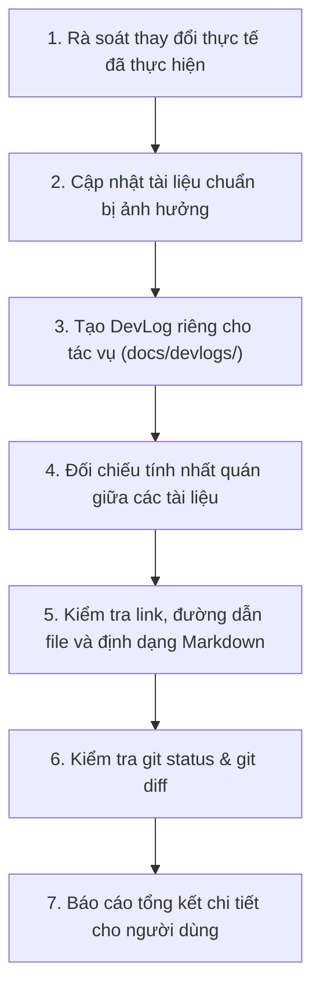

# AI Working Rules & Operating Contract

**Repository:** `Skill- and Labor Market Demand–Based Career Recommendation System`  
**Target Audience:** All AI Agents, Autonomous Coding Assistants, and Human Contributors  
**Status:** Mandatory Operating Policy — Enforced for every task

---

## 1. Mục đích & Nguyên tắc cốt lõi (Purpose & Core Principle)

Tài liệu này là **hợp đồng vận hành bắt buộc** (mandatory operating contract) đối với mọi AI agent làm việc trong repository này. Mọi agent khi bắt đầu một phiên làm việc mới (kể cả khi không có ngữ cảnh hội thoại trước đó) đều phải đọc, hiểu và tuân thủ tuyệt đối các quy tắc dưới đây.

> [!IMPORTANT]
> **Không có tác vụ nào được coi là hoàn thành nếu thiếu tài liệu đồng hành.**
> Mọi thay đổi về mã nguồn, cấu hình, kiến trúc hoặc nghiệp vụ đều phải được phản ánh vào tài liệu chuẩn (canonical documentation) và được ghi nhận lại trong một DevLog độc lập trước khi kết thúc tác vụ.

---

## 2. Quy tắc A — Tải ngữ cảnh bắt buộc (Mandatory Context Loading)

Trước khi thực hiện bất kỳ hành động chỉnh sửa mã nguồn hoặc tài liệu nào, mọi AI agent bắt buộc phải:

1. **Đọc toàn bộ file này (`AI_RULES.md`)**.
2. **Đọc [`docs/README.md`](file:///d:/Khai%20Van/KhaiVan%20Data/Dai%20Hoc/Skill--and-Labor-Market-Demand-Based-Career-Recommendation-System/docs/README.md)** để nắm cấu trúc tri thức hiện tại của dự án.
3. **Đọc các tài liệu chuẩn liên quan trực tiếp đến tác vụ** (nằm trong `docs/requirements/`, `docs/architecture/`, `docs/database/`, `docs/api/`, `docs/decisions/`, hoặc `docs/development/`).
4. **Kiểm tra trạng thái Git (`git status`, `git diff`)** để nhận biết các thay đổi chưa được commit và tránh ghi đè lên công việc dở dang của người khác.
5. **Xác định các ràng buộc kỹ thuật & quyết định đã có**: Agent không được tự ý xóa bỏ, lờ đi hoặc ngầm mâu thuẫn với các quyết định kiến trúc, công nghệ và nghiệp vụ đã được thống nhất.

---

## 3. Quy tắc B — Tài liệu là một phần của tác vụ (Documentation Is Part of the Task)

**Mọi thay đổi thực chất (substantive changes) phải bao gồm cập nhật tài liệu tương ứng trong cùng một phiên làm việc / Pull Request.**

### Các loại thay đổi bắt buộc phải cập nhật tài liệu:
* **Yêu cầu & Tính năng (Requirements & Features):** Bổ sung, điều chỉnh yêu cầu chức năng (FR) hoặc phi chức năng (NFR) $\rightarrow$ Cập nhật [`docs/requirements/`](file:///d:/Khai%20Van/KhaiVan%20Data/Dai%20Hoc/Skill--and-Labor-Market-Demand-Based-Career-Recommendation-System/docs/requirements/).
* **Tác nhân & Ca sử dụng (Actors & Use Cases):** Thêm mới hoặc thay đổi phạm vi của Actor, Use Case $\rightarrow$ Cập nhật [`docs/requirements/actors-and-use-cases.md`](file:///d:/Khai%20Van/KhaiVan%20Data/Dai%20Hoc/Skill--and-Labor-Market-Demand-Based-Career-Recommendation-System/docs/requirements/actors-and-use-cases.md).
* **Kiến trúc hệ thống (System Architecture):** Điều chỉnh ranh giới module, trách nhiệm thành phần, luồng dữ liệu $\rightarrow$ Cập nhật [`docs/architecture/`](file:///d:/Khai%20Van/KhaiVan%20Data/Dai%20Hoc/Skill--and-Labor-Market-Demand-Based-Career-Recommendation-System/docs/architecture/).
* **Cơ sở dữ liệu (Database Schema):** Thêm bảng, quan hệ, ràng buộc khóa, migration script $\rightarrow$ Cập nhật [`docs/database/`](file:///d:/Khai%20Van/KhaiVan%20Data/Dai%20Hoc/Skill--and-Labor-Market-Demand-Based-Career-Recommendation-System/docs/database/).
* **Giao tiếp API (REST API Contracts):** Thêm/sửa endpoint, request payload, response schema, mã lỗi $\rightarrow$ Cập nhật [`docs/api/`](file:///d:/Khai%20Van/KhaiVan%20Data/Dai%20Hoc/Skill--and-Labor-Market-Demand-Based-Career-Recommendation-System/docs/api/).
* **Bảo mật & Xác thực (Security & Auth):** Thay đổi luồng JWT, phân quyền Spring Security $\rightarrow$ Cập nhật [`docs/architecture/`](file:///d:/Khai%20Van/KhaiVan%20Data/Dai%20Hoc/Skill--and-Labor-Market-Demand-Based-Career-Recommendation-System/docs/architecture/) & [`docs/api/`](file:///d:/Khai%20Van/KhaiVan%20Data/Dai%20Hoc/Skill--and-Labor-Market-Demand-Based-Career-Recommendation-System/docs/api/).
* **Công nghệ & Cấu hình (Tech Stack & Config):** Thay đổi dependency, thư viện, cấu hình build $\rightarrow$ Cập nhật [`docs/decisions/`](file:///d:/Khai%20Van/KhaiVan%20Data/Dai%20Hoc/Skill--and-Labor-Market-Demand-Based-Career-Recommendation-System/docs/decisions/) & [`docs/development/`](file:///d:/Khai%20Van/KhaiVan%20Data/Dai%20Hoc/Skill--and-Labor-Market-Demand-Based-Career-Recommendation-System/docs/development/).
* **Môi trường & Docker (Docker & Deployment):** Chỉnh sửa Dockerfile, docker-compose, biến môi trường $\rightarrow$ Cập nhật [`.env.example`](file:///d:/Khai%20Van/KhaiVan%20Data/Dai%20Hoc/Skill--and-Labor-Market-Demand-Based-Career-Recommendation-System/.env.example) & [`docs/development/`](file:///d:/Khai%20Van/KhaiVan%20Data/Dai%20Hoc/Skill--and-Labor-Market-Demand-Based-Career-Recommendation-System/docs/development/).
* **Nghiên cứu mới (Research Findings):** Các phát hiện khoa học làm thay đổi quyết định dự án $\rightarrow$ Cập nhật [`docs/research/`](file:///d:/Khai%20Van/KhaiVan%20Data/Dai%20Hoc/Skill--and-Labor-Market-Demand-Based-Career-Recommendation-System/docs/research/).

> [!CAUTION]
> Không sửa đổi tài liệu không liên quan chỉ để tạo cảm giác "hoạt động tích cực". Các sửa đổi nhỏ chỉ mang tính định dạng cú pháp không cần sửa tài liệu kiến trúc, nhưng vẫn phải tuân thủ quy định ghi nhận tác vụ tại DevLog.

---

## 4. Quy tắc C — Chính sách DevLog bắt buộc (Mandatory DevLog Policy)

Mỗi tác vụ hoàn thành mang tính thực chất phải tạo một file DevLog mới dưới thư mục `docs/devlogs/`.

> [!WARNING]
> **Tuyệt đối KHÔNG ghi nối tiếp (append) vào một file `devlog.md` dùng chung.**  
> Dự án hỗ trợ nhiều người và nhiều AI agent cộng tác song song. Việc dùng một file duy nhất sẽ gây xung đột Git (merge conflicts). Mỗi tác vụ phải có file nhật ký độc lập.

### 4.1. Quy ước đặt tên file DevLog
Định dạng bắt buộc:
```text
docs/devlogs/YYYY-MM-DD-<task-id-or-branch-slug>-<short-description>.md
```
*Ví dụ:*
* `docs/devlogs/2026-10-09-init-ai-rules-and-docs.md`
* `docs/devlogs/2026-10-12-issue-14-add-postgres-migration.md`

Nếu có mã Issue / Pull Request, hãy sử dụng mã đó. Nếu không, dùng slug ngắn gọn mô tả tác vụ và kiểm tra trước để đảm bảo file chưa từng tồn tại.

### 4.2. Cấu trúc bắt buộc của một file DevLog
Mỗi file DevLog phải tuân thủ đúng template tại [`docs/devlogs/DEVLOG-TEMPLATE.md`](file:///d:/Khai%20Van/KhaiVan%20Data/Dai%20Hoc/Skill--and-Labor-Market-Demand-Based-Career-Recommendation-System/docs/devlogs/DEVLOG-TEMPLATE.md) gồm 6 phần:
1. **Mục tiêu (Objective):** Lý do thực hiện tác vụ.
2. **Thay đổi thực tế (Changes):** Những gì đã được sửa đổi, tạo mới hoặc xóa bỏ.
3. **Khu vực bị ảnh hưởng (Affected Areas):** Danh sách đường dẫn file mã nguồn và tài liệu liên quan.
4. **Quyết định quan trọng (Decisions):** Các lựa chọn kỹ thuật và lý do chọn.
5. **Kiểm tra & Xác thực (Validation):** Lệnh test, build, lint hoặc kiểm tra thủ công thực tế đã chạy và kết quả cụ thể.
6. **Công việc tồn đọng (Outstanding Work):** Giới hạn kỹ thuật, câu hỏi chưa giải quyết, bước tiếp theo.

### 4.3. Tiêu chuẩn chất lượng DevLog:
* Phân biệt rõ ràng giữa công việc **đã hoàn thành thực tế** và công việc **đang đề xuất**.
* **Tuyệt đối không tuyên bố kiểm thử/build thành công nếu chưa thực sự chạy lệnh.**
* Không sao chép toàn bộ nội dung tài liệu chuẩn vào DevLog; hãy dùng đường dẫn liên kết (links).
* **Không sửa đổi hoặc xóa các DevLog lịch sử** khi hệ thống thay đổi sau này. Hãy tạo một DevLog mới ghi nhận thay đổi mới.

---

## 5. Quy tắc D — Tài liệu chuẩn phản ánh trạng thái hiện tại (Canonical Documentation Must Track Current System)

DevLog là **hồ sơ lịch sử theo thời gian**. Ngược lại, các thư mục sau là **tài liệu chuẩn phản ánh trạng thái hiện tại (Current-State Documentation)**:

* [`docs/requirements/`](file:///d:/Khai%20Van/KhaiVan%20Data/Dai%20Hoc/Skill--and-Labor-Market-Demand-Based-Career-Recommendation-System/docs/requirements/) — Yêu cầu nghiệp vụ, tiêu chuẩn chấp nhận, danh sách Actor và Use Case.
* [`docs/architecture/`](file:///d:/Khai%20Van/KhaiVan%20Data/Dai%20Hoc/Skill--and-Labor-Market-Demand-Based-Career-Recommendation-System/docs/architecture/) — Kiến trúc hệ thống, các module, ranh giới và tương tác thành phần.
* [`docs/database/`](file:///d:/Khai%20Van/KhaiVan%20Data/Dai%20Hoc/Skill--and-Labor-Market-Demand-Based-Career-Recommendation-System/docs/database/) — Thiết kế CSDL quan hệ, bảng, khóa ngoại, chỉ mục, chiến lược migration.
* [`docs/api/`](file:///d:/Khai%20Van/KhaiVan%20Data/Dai%20Hoc/Skill--and-Labor-Market-Demand-Based-Career-Recommendation-System/docs/api/) — Đặc tả REST API, URL path, headers, request/response body, mã lỗi.
* [`docs/decisions/`](file:///d:/Khai%20Van/KhaiVan%20Data/Dai%20Hoc/Skill--and-Labor-Market-Demand-Based-Career-Recommendation-System/docs/decisions/) — Hồ sơ quyết định kiến trúc quan trọng (ADR).
* [`docs/development/`](file:///d:/Khai%20Van/KhaiVan%20Data/Dai%20Hoc/Skill--and-Labor-Market-Demand-Based-Career-Recommendation-System/docs/development/) — Hướng dẫn cài đặt môi trường, quy trình Docker, build và test.

### Quy định chống bịa đặt (Anti-Hallucination Policy):
* **Không tạo tài liệu rỗng hoặc tạo nội dung giữ chỗ vô nghĩa (meaningless placeholders).**
* **Không tự ý bịa đặt (fabricate) thiết kế chưa được thống nhất:** Nếu một khía cạnh chưa được phân tích hoặc quyết định, hãy ghi rõ trạng thái: **`TBD` (To Be Decided / Chưa quyết định)** hoặc **`Chưa xác định`**, kèm theo danh sách các câu hỏi mở cần giải quyết.
* Khi một quyết định bị thay thế, hãy cập nhật trạng thái trong tài liệu chuẩn và lưu giữ lý do lịch sử trong ADR hoặc DevLog tương ứng.

---

## 6. Quy tắc E — Hồ sơ quyết định kiến trúc (Architectural Decision Records - ADR)

Mọi quyết định kỹ thuật hoặc kiến trúc có tầm ảnh hưởng lớn phải được ghi nhận dưới dạng một file ADR riêng biệt trong [`docs/decisions/`](file:///d:/Khai%20Van/KhaiVan%20Data/Dai%20Hoc/Skill--and-Labor-Market-Demand-Based-Career-Recommendation-System/docs/decisions/) theo mẫu [`docs/decisions/ADR-TEMPLATE.md`](file:///d:/Khai%20Van/KhaiVan%20Data/Dai%20Hoc/Skill--and-Labor-Market-Demand-Based-Career-Recommendation-System/docs/decisions/ADR-TEMPLATE.md).

Mỗi ADR bao gồm:
* **Tiêu đề & Mã định danh:** `ADR-YYYY-MM-DD-<slug>.md` hoặc `ADR-000X-<slug>.md`.
* **Trạng thái (Status):** `Proposed` (Đề xuất), `Accepted` (Chấp thuận), `Superseded` (Bị thay thế), `Rejected` (Từ chối).
* **Bối cảnh & Vấn đề (Context):** Vấn đề kỹ thuật cần giải quyết.
* **Các phương án cân nhắc (Options Considered):** Ưu và nhược điểm từng phương án.
* **Quyết định & Lý do (Decision & Rationale):** Phương án được chọn và căn cứ lựa chọn.
* **Hệ quả & Đánh đổi (Consequences & Trade-offs):** Tác động tích cực và tiêu cực.

> [!NOTE]
> AI agent không được tự ý biến một đề xuất cá nhân thành quyết định đã được duyệt của dự án. Phải phân biệt rõ giữa **Đề xuất kỹ thuật (Recommendation)** và **Quyết định đã được đội ngũ dự án thông qua (Accepted Decision)**.

---

## 7. Quy tắc F — An toàn đa Agent & Quản trị Git (Multi-Agent & Git Safety)

Trong môi trường có nhiều agent hoặc lập trình viên cùng tham gia:

1. **Mỗi tác vụ một file DevLog riêng biệt:** Tránh xung đột trên cùng một file log.
2. **Không sửa DevLog của agent khác:** Trừ khi sửa lỗi chính tả rõ ràng hoặc cập nhật bổ sung được yêu cầu cụ thể.
3. **Kiểm tra trùng tên trước khi tạo file:** Dùng công cụ kiểm tra xem file đã tồn tại hay chưa.
4. **Hòa nhập thay đổi thay vì ghi đè (Integrate, do not overwrite):** Nếu hai tác vụ cùng cập nhật một tài liệu chuẩn, phải kết hợp nội dung của cả hai thay vì xóa phần đóng góp của người khác.
5. **Tôn trọng uncommitted changes:** Không xóa hoặc hoàn tác (revert) công việc chưa commit của người khác nếu không có chỉ thị rõ ràng.
6. **Không tự ý commit / push / rewrite Git history:** Trừ khi người dùng ra lệnh cụ thể bằng văn bản.
7. **Rà soát `git diff` trước khi kết thúc:** Luôn kiểm tra lại để phát hiện các dòng code hoặc file bị xóa vô tình.

---

## 8. Quy tắc G — Độ chính xác, Bảo mật & Khả năng truy xuất (Accuracy, Security & Traceability)

* **Không bịa đặt (Never fabricate):** Không tạo trích dẫn tài liệu giả, không bịa đặt kết quả kiểm thử, không tự nhận tính năng đã xong khi chưa cài đặt.
* **Truy xuất nguồn gốc học thuật (Scholarly Traceability):** Mọi tuyên bố hoặc luận điểm nghiên cứu bên ngoài phải có trích dẫn khoa học có thể kiểm chứng (DOI, arXiv, báo cáo tổ chức uy tín như O\*NET, ESCO, BLS).
* **Tuyệt đối không lưu trữ bí mật (No Secrets in Code or Docs):** Không commit mật khẩu, khóa bí mật JWT, API keys, certificates vào tài liệu hoặc mã nguồn. Luôn dùng file mẫu `.env.example` với giá trị giữ chỗ (placeholders).
* **Nhất quán giữa tài liệu và mã nguồn:** Tài liệu phải đồng bộ với mã nguồn thực tế trong `frontend/`, `backend/`, `docker/`.
* **Ngôn ngữ sử dụng (Language Policy):**
  * Sử dụng **tiếng Việt** cho các báo cáo, tài liệu học thuật chính, khảo sát hiện trạng, Actor & Use Case và tổng quan dự án.
  * Giữ nguyên **tiếng Anh** cho các định danh kỹ thuật (identifiers), tên hàm, biến, schema, API endpoint, và thuật ngữ chuyên ngành phổ biến.

---

## 9. Quy tắc H — Quy trình kết thúc tác vụ bắt buộc (Mandatory End-of-Task Workflow)

Trước khi tuyên bố một tác vụ mang tính thực chất đã hoàn thành, mọi AI agent bắt buộc phải thực hiện đủ 7 bước sau:



1. **Rà soát thay đổi (Review Changes):** Liệt kê chính xác những gì đã thêm, sửa, xóa.
2. **Cập nhật tài liệu chuẩn (Update Canonical Docs):** Đồng bộ hóa các tài liệu tương ứng trong `docs/`.
3. **Tạo DevLog mới (Create DevLog):** Viết file nhật ký mới theo chuẩn tại `docs/devlogs/YYYY-MM-DD-...md`.
4. **Kiểm tra mâu thuẫn (Verify No Contradictions):** Đảm bảo tài liệu mới không mâu thuẫn với các tài liệu đã có.
5. **Kiểm tra liên kết (Check Links & Format):** Xác nhận các đường dẫn tệp (file links) và cú pháp Markdown chính xác.
6. **Kiểm tra trạng thái Git (Inspect Git):** Chạy `git status` và `git diff` để đảm bảo không có file rác hoặc thay đổi ngoài ý muốn.
7. **Báo cáo kết thúc (Report to User):** Báo cáo rõ ràng:
   * Danh sách file đã thay đổi.
   * Danh sách tài liệu chuẩn đã cập nhật.
   * Đường dẫn file DevLog mới.
   * Các bước kiểm tra/xác thực đã thực tế thực hiện.
   * Các vấn đề chưa giải quyết hoặc công việc tồn đọng (nếu có).

> [!TIP]
> Nếu tác vụ không thể hoàn thành toàn bộ vì thiếu thông tin hoặc gặp rào cản kỹ thuật, hãy ghi nhận trung thực những gì còn tồn đọng trong DevLog và báo cáo cho người dùng thay vì báo cáo thành công giả mạo.
