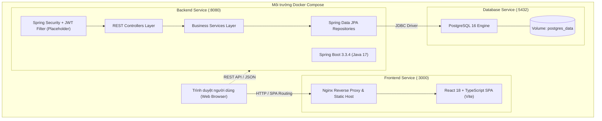

# Kiến trúc hệ thống (System Architecture)

**Dự án:** Skill- and Labor Market Demand–Based Career Recommendation System  
**Trạng thái:** Kiến trúc cơ sở ban đầu (Initial Baseline Architecture) — Sẵn sàng mở rộng  
**Phiên bản:** 1.0 (Khung dự án & Tài liệu sống)

---

## 1. Tổng quan kiến trúc hiện tại (Current Architectural Baseline)

Hệ thống được thiết kế theo mô hình phân tầng hướng dịch vụ (Tiered / Service-Oriented Architecture), đóng gói toàn diện bằng Docker:

---

## 2. Các thành phần đã được thiết lập (Established Components)

### 2.1. Tầng Giao diện người dùng (Frontend Tier)
* **Công nghệ:** React 18, TypeScript 5.6, Vite 5.4.
* **Cơ chế triển khai:** Đóng gói tĩnh qua multi-stage Dockerfile (`node:20-alpine` build $\rightarrow$ `nginx:alpine` phục vụ tĩnh).
* **Định tuyến máy chủ:** File [`frontend/nginx.conf`](file:///d:/Khai%20Van/KhaiVan%20Data/Dai%20Hoc/Skill--and-Labor-Market-Demand-Based-Career-Recommendation-System/frontend/nginx.conf) hỗ trợ điều hướng SPA fallback về `index.html`.
* **Trạng thái logic:** Đã có khung ứng dụng hiển thị trạng thái ban đầu; chưa tích hợp giao diện nghiệp vụ cụ thể.

### 2.2. Tầng Máy chủ ứng dụng (Backend Tier)
* **Công nghệ:** Spring Boot 3.3.4, Java 17, Apache Maven.
* **Cấu trúc gói phân tầng chuẩn (`com.cnpm.careerrecommendation`):**
  * `config/`: Cấu hình hệ thống (WebMvc, Security, Database).
  * `controller/`: Điểm tiếp nhận yêu cầu HTTP và phân phối phản hồi JSON.
  * `service/`: Tầng xử lý logic nghiệp vụ và thuật toán gợi ý.
  * `repository/`: Tầng giao tiếp dữ liệu Spring Data JPA.
  * `entity/`: Tầng định nghĩa các đối tượng thực thể CSDL (JPA Entities).
  * `dto/`: Đối tượng truyền tải dữ liệu giữa Client và Server.
* **Trạng thái logic:** Đã có điểm khởi chạy [`CareerRecommendationApplication.java`](file:///d:/Khai%20Van/KhaiVan%20Data/Dai%20Hoc/Skill--and-Labor-Market-Demand-Based-Career-Recommendation-System/backend/src/main/java/com/cnpm/careerrecommendation/CareerRecommendationApplication.java); chưa tạo lớp giả lập (fake class) nào trước khi có thiết kế chi tiết.

### 2.3. Tầng Cơ sở dữ liệu (Database Tier)
* **Công nghệ:** PostgreSQL 16 (chạy container `postgres:16-alpine`).
* **Cấu hình kết nối:** Tự động nạp qua biến môi trường thông qua [`backend/src/main/resources/application.yml`](file:///d:/Khai%20Van/KhaiVan%20Data/Dai%20Hoc/Skill--and-Labor-Market-Demand-Based-Career-Recommendation-System/backend/src/main/resources/application.yml).
* **Lưu trữ dữ liệu:** Persistent volume `postgres_data`.

### 2.4. Tầng Bảo mật cơ sở (Security Baseline)
* Đã nạp thư viện `spring-boot-starter-security` và bộ thư viện JJWT `0.12.6`.
* Chưa kích hoạt các bộ lọc phân quyền chi tiết (do chưa có nghiệp vụ người dùng).

---

## 3. Các thành phần và quyết định kiến trúc đang chờ xác lập (TBD Components)

Nhằm bảo đảm nguyên tắc **không bịa đặt thiết kế chưa được phê duyệt**, các thành phần dưới đây được đánh dấu là **`TBD` (To Be Decided / Đang phân tích)**:

| Hạng mục kiến trúc | Trạng thái | Câu hỏi kỹ thuật cần giải quyết tiếp theo |
|---|---|---|
| **Cơ chế tích hợp LLM / NLP bóc tách kỹ năng (UC01)** | `TBD` | Xử lý trực tiếp qua Python microservice (FastAPI/LangChain) hay gọi API LLM (OpenAI/Anthropic/Gemini) trực tiếp từ Spring Boot? |
| **Pipeline thu thập & làm sạch dữ liệu thị trường LMI (UC05)** | `TBD` | Sử dụng crawler nội bộ, ETL batch job định kỳ hay tích hợp API của bên thứ ba (O\*NET / ESCO API)? |
| **Thuật toán tính điểm tương thích kết hợp thị trường (UC02)** | `TBD` | Định nghĩa công thức hàm mục tiêu chi tiết $F(Sim, Demand)$, cơ chế trọng số tùy chỉnh và thư viện vector search (pgvector hay Elasticsearch)? |
| **Quản lý phiên & Token Revocation** | `TBD` | Lưu trữ blacklist JWT trên Redis hay sử dụng Refresh Token rotation lưu trong PostgreSQL? |
| **Công cụ Migration CSDL** | `TBD` | Sử dụng Flyway hay Liquibase để quản lý lịch sử thay đổi schema PostgreSQL? |
