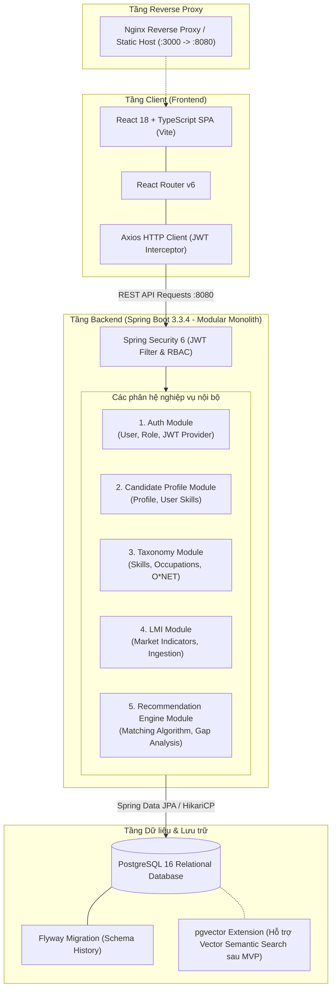
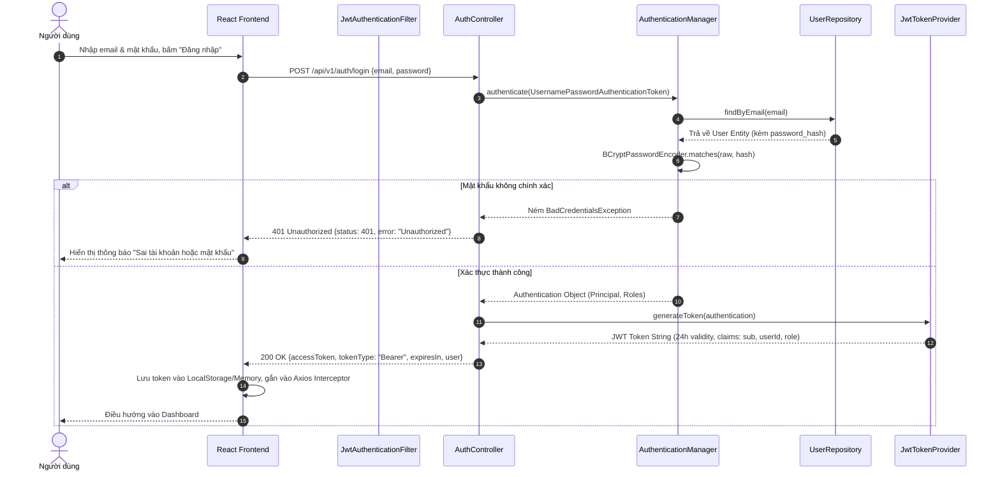
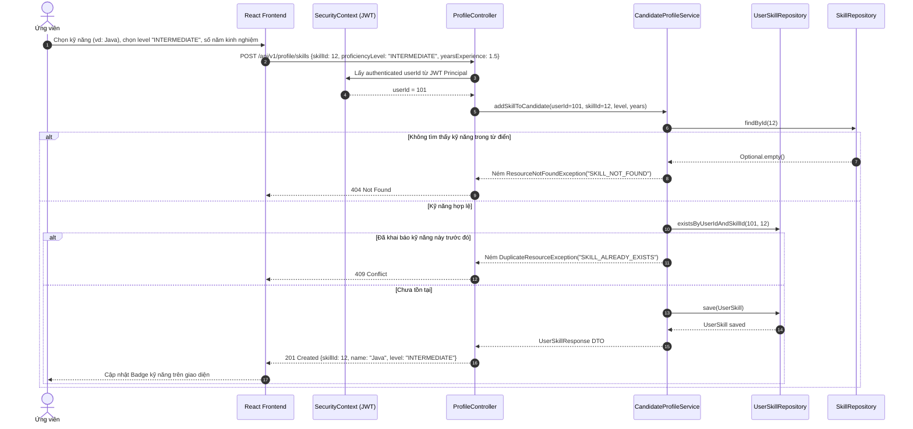
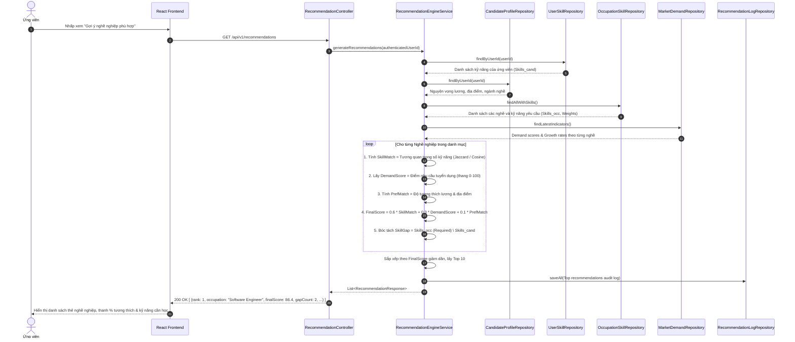
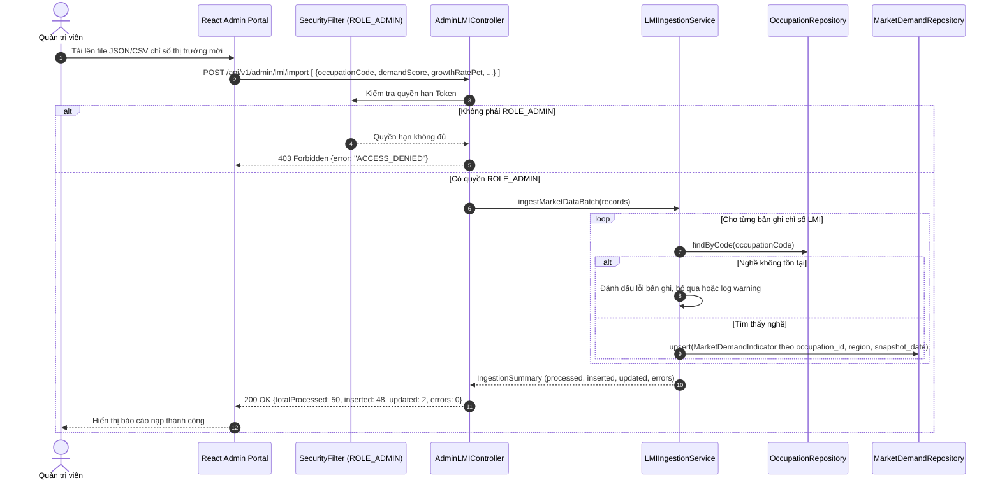

# Kiến trúc hệ thống (System Architecture Specification)

**Dự án:** Skill- and Labor Market Demand–Based Career Recommendation System
*(Hệ thống gợi ý nghề nghiệp dựa trên kỹ năng cá nhân và nhu cầu thị trường lao động)*
**Trạng thái:** Hoàn thiện cho phát triển song song Tuần 2–5 (Production-Ready Architecture)
**Tài liệu tham chiếu chuẩn:** [`ADDITIONAL_DOC/Báo cáo đồ án.docx`](../requirements/current-state.md), [`AI_RULES.md`](../../AI_RULES.md)

---

## 1. Mục tiêu hệ thống & Phạm vi MVP (System Purpose & MVP Scope)

### 1.1. Mục tiêu cốt lõi
Hệ thống giải quyết bài toán định hướng nghề nghiệp bằng cách kết nối 3 tầng dữ liệu:
1. **Hồ sơ năng lực cá nhân:** Kỹ năng tự khai báo kèm mức độ thành thạo, học vấn, kinh nghiệm và nguyện vọng nghề nghiệp.
2. **Từ điển phân loại chuẩn hóa (Occupational Taxonomy):** Chuẩn O\*NET / ESCO phân định rõ kỹ năng cốt lõi (*essential*) và bổ trợ (*optional*).
3. **Chỉ báo nhu cầu thị trường lao động (Labor Market Information - LMI):** Tốc độ tăng trưởng ngành, mức độ thiếu hụt nhân lực và mức lương tham khảo.

### 1.2. Phạm vi MVP thống nhất (Agreed MVP Scope)
Theo đặc tả chuẩn hóa trong tài liệu đồ án:
* **Bao gồm trong MVP:**
  * Xác thực người dùng và phân quyền RBAC (`ROLE_CANDIDATE`, `ROLE_ADMIN`).
  * Quản lý hồ sơ ứng viên, học vấn, kinh nghiệm, danh mục kỹ năng và mức độ thành thạo.
  * Tra cứu, lọc danh mục nghề nghiệp và xem xu hướng thị trường lao động.
  * Thuật toán gợi ý nghề nghiệp kết hợp độ tương đồng kỹ năng ($Sim$) và trọng số thị trường ($Demand$).
  * Chẩn đoán khoảng cách kỹ năng ($\Delta$) và giải thích căn cứ gợi ý.
  * Giao diện quản trị cập nhật danh mục kỹ năng/nghề và nhập dữ liệu LMI.
* **Loại trừ khỏi phạm vi MVP (Deferred / Out of Scope):**
  * Tích hợp thanh toán, hợp đồng, escrow (các nội dung sao chép nhầm từ mẫu đồ án khác).
  * Ứng dụng di động native (hệ thống tập trung web responsive).
  * Vi dịch vụ AI riêng biệt hoặc hạ tầng streaming phân tán phức tạp (ưu tiên Modular Monolith để 6 thành viên hoàn thành trong 5 tuần).

---

## 2. Kiến trúc tổng thể: Modular Monolith (System Decomposition)

Để đáp ứng ràng buộc thời gian 5 tuần và quy mô đội ngũ 6 thành viên, hệ thống áp dụng mô hình **Modular Monolith** trên nền tảng Spring Boot 3.3.4 (Java 17). Ứng dụng được chia thành 5 phân hệ logic với ranh giới rõ ràng, giao tiếp nội bộ qua Service Interfaces và Event Publication:



* **Kiểm tra trạng thái dịch vụ (Service Health Check - GAP-02):** Module dùng chung (`common`) cung cấp endpoint công khai `GET /api/health` trả về `{"status": "UP"}` với mã `200 OK`, đóng vai trò là điểm kiểm tra tình trạng sống (liveness probe) tức thời cho Docker Compose, Nginx và Frontend mà không phụ thuộc CSDL.

---

## 3. Đặc tả ranh giới phân hệ & Trách nhiệm thành viên (Module Boundaries)

**Cập nhật phân công W1 ngày 2026-10-29:** Theo sheet `Task` của
`CNPM Chuyên Sâu - Nhóm 4.xlsx`, W1-T5 (Auth/JWT) giao **Đoàn Việt Khang**;
W1-T3 (backend nền tảng) giao Phạm Ngọc Gia Khang; W1-T4 (data/mapping) giao
Huỳnh Long Bảo Khanh. Ma trận Tuần 2–5 bên dưới là kế hoạch trước đó,
không dùng để thay thế phân công W1 trong Excel.

Hiện thực W1-T5 dùng `module/auth/{controller,service,dto,entity,repository}`,
`common/security`, `common/exception`, `common/dto` và `config/SecurityConfig`.
`User`/`UserRepository` thuộc auth và là điểm phối hợp với W1-T4; không tạo một
User entity thứ hai ở package phẳng. `AuthenticatedUser(userId,email,role)` là
principal không chứa password hash để các module nhận qua `@AuthenticationPrincipal`.

JWT filter xác minh chữ ký/claim, kiểm tra User còn active và role/email khớp DB,
rồi đưa principal vào SecurityContext. Security stateless, không phát session cookie,
không bật HTTP Basic/form login; CSRF tắt vì dùng Bearer header, không cookie auth.
CORS theo danh sách origin cấu hình; không dùng wildcard credentials.
Chỉ POST register/login và GET health/taxonomy được công khai; admin cần ADMIN,
profile/recommendation cần CANDIDATE; endpoint khác mặc định bị chặn.
Chưa tạo controller nghiệp vụ cho các module khác trong W1-T5.


| STT | Phân hệ (Module) | Trách nhiệm chính | Thực thể quản lý | Thành viên phụ trách |
| :---: | :--- | :--- | :--- | :--- |
| **1** | **Auth & Security** | Đăng ký, đăng nhập, cấp phát JWT, xác thực RBAC | `User`, `Role` | Bùi Vạn Khải (24520719) |
| **2** | **Candidate Profile** | Hồ sơ năng lực, nguyện vọng lương, kỹ năng đã có | `CandidateProfile`, `UserSkill` | Phạm Ngọc Gia Khang (24520765) |
| **3** | **Taxonomy & Occupations** | Danh mục kỹ năng O\*NET/ESCO, chức danh nghề nghiệp | `Skill`, `SkillCategory`, `Occupation`, `OccupationSkill` | Lương Phúc Khang (24520747) |
| **4** | **LMI (Labor Market Info)** | Chỉ số nhu cầu tuyển dụng, tỷ lệ tăng trưởng, thống kê | `MarketDemandIndicator` | Lương Phúc Khang (24520747) |
| **5** | **Recommendation Engine** | Thuật toán đối sánh kỹ năng, tính điểm, chẩn đoán gap | `RecommendationLog` | Bùi Vạn Khải (24520719) |
| **6** | **Candidate Frontend** | Màn hình đăng nhập, hồ sơ, kỹ năng, bảng gợi ý | React Components | Đoàn Việt Khang (24520730) |
| **7** | **Explorer & Admin UI** | Màn hình tra cứu nghề nghiệp, trực quan hóa LMI, Admin | React Components | Huỳnh Long Bảo Khanh (24520781) |
| **8** | **DevOps & QA Testing** | Flyway migration, Docker Compose, CI/CD, Test | Docker, Flyway, Tests | Phan Nguyễn Thông (24521722) |

---

## 4. Các luồng xử lý tuần tự nghiệp vụ cốt lõi (Core Sequence Diagrams)

### 4.1. Luồng Xác thực & Phân quyền (Authentication & Token Issuance)



### 4.2. Luồng Khai báo Hồ sơ & Kỹ năng Ứng viên (Candidate Profile & Skills Submission)



### 4.3. Luồng Gợi ý Nghề nghiệp & Chẩn đoán Khoảng cách Kỹ năng (Recommendation & Skill Gap)



### 4.4. Luồng Nạp & Đồng bộ Dữ liệu Quản trị LMI (Admin LMI Data Ingestion)



---

## 5. Công thức toán học đề xuất (Recommendation Engine Mathematics)

Điểm phù hợp tổng hợp ($\text{FinalScore}$) giữa ứng viên $u$ và nghề nghiệp $j$ được tính toán minh bạch:

$$\text{FinalScore}(u, j) = 0.6 \cdot \text{SkillMatch}(u, j) + 0.3 \cdot \text{DemandScore}(j) + 0.1 \cdot \text{PrefMatch}(u, j)$$

Trong đó:
1. **Điểm khớp kỹ năng ($\text{SkillMatch} \in [0, 100]$):**
   $$\text{SkillMatch}(u, j) = \frac{\sum_{s \in S_u \cap S_j} w_{j,s} \cdot \mu(u, s)}{\sum_{s \in S_j} w_{j,s}} \times 100$$
   * $S_u$: Tập kỹ năng ứng viên khai báo.
   * $S_j$: Tập kỹ năng yêu cầu của nghề nghiệp $j$.
   * $w_{j,s}$: Trọng số quan trọng của kỹ năng $s$ đối với nghề $j$ ($w_{j,s} \in [0.0, 1.0]$).
   * $\mu(u, s)$: Hệ số thành thạo kỹ năng của ứng viên ($\text{BEGINNER}=0.5$, $\text{INTERMEDIATE}=0.8$, $\text{ADVANCED}=1.0$, $\text{EXPERT}=1.0$).

2. **Điểm nhu cầu thị trường ($\text{DemandScore} \in [0, 100]$):**
   Lấy trực tiếp từ bảng `market_demand_indicators` dựa trên kỳ khảo sát gần nhất.

3. **Điểm tương thích nguyện vọng ($\text{PrefMatch} \in [0, 100]$):**
   Đánh giá độ khớp về dải lương kỳ vọng và địa điểm làm việc ưu tiên.

4. **Tập khoảng cách kỹ năng ($\text{SkillGap}$):**
   $$\text{SkillGap}(u, j) = S_j \setminus S_u = \{s \in S_j \mid s \notin S_u\}$$
   Được phân tách thành:
   * **Khoảng cách cốt lõi (Essential Gaps):** $\{s \in \text{SkillGap} \mid \text{is\_required}(s) = \text{true}\}$.
   * **Khoảng cách bổ trợ (Optional Gaps):** $\{s \in \text{SkillGap} \mid \text{is\_required}(s) = \text{false}\}$.

---

## 6. Xử lý lỗi tập trung & Chuẩn hóa phản hồi (Error Handling)

Mọi ngoại lệ trên toàn hệ thống được bắt tại `GlobalExceptionHandler` (`@RestControllerAdvice`) và chuyển đổi thành định dạng chuẩn:

```json
{
  "timestamp": "2026-10-22T15:30:00Z",
  "status": 400,
  "error": "Bad Request",
  "message": "Dữ liệu đầu vào không hợp lệ",
  "path": "/api/v1/profile/skills",
  "errors": [
    {
      "field": "proficiencyLevel",
      "rejectedValue": null,
      "reason": "Cấp độ kỹ năng phải thuộc một trong các giá trị: BEGINNER, INTERMEDIATE, ADVANCED, EXPERT"
    }
  ]
}
```
