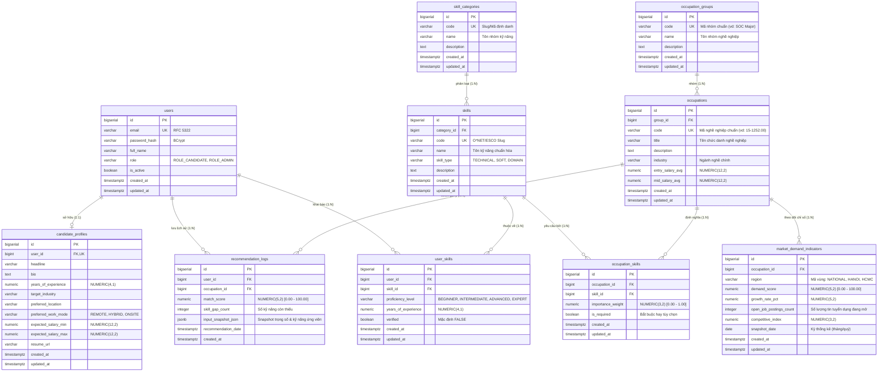

# Thiết kế cơ sở dữ liệu (Database Design Specification)

**Hệ quản trị CSDL:** PostgreSQL 16  
**Cơ chế ORM:** Spring Data JPA / Hibernate  
**Công cụ quản lý Migration:** Flyway ([`ADR-0002`](../decisions/ADR-0002-database-migration-tool.md)) 
**Chiến lược Hibernate ddl-auto:** `validate` (nghiêm cấm `create`, `create-drop`, `update` trên môi trường chuẩn) 
**Trạng thái thiết kế:** Đã hoàn thành thiết kế Baseline Schema (10 bảng thực thể cốt lõi)

---

## 1. Cơ sở hạ tầng kết nối & Quản trị Migration

Hệ thống kết nối PostgreSQL chuẩn hóa qua biến môi trường thông qua [`backend/src/main/resources/application.yml`](../../backend/src/main/resources/application.yml):

* **Datasource URL:** `jdbc:postgresql://${POSTGRES_HOST:localhost}:${POSTGRES_PORT:5432}/${POSTGRES_DB:career_recommendation_db}`
* **Username / Password:** Tự động nạp qua biến môi trường `${POSTGRES_USER}` và `${POSTGRES_PASSWORD}`.
* **Driver:** `org.postgresql.Driver`
* **Hibernate Dialect:** `org.hibernate.dialect.PostgreSQLDialect`
* **Flyway Migration:** Tự động thực thi các migration script đặt tại `classpath:db/migration` khi ứng dụng khởi động.

> [!IMPORTANT]
> Mọi thay đổi cấu trúc bảng bắt buộc phải tạo file migration SQL phiên bản mới (ví dụ `V2__...sql`). Không bao giờ sửa trực tiếp file migration đã được áp dụng.

### 1.1. Đánh giá và Quyết định kỹ thuật đối với pgvector (pgvector Evaluation & Decision)

* **Căn cứ từ tài liệu đồ án (`ADDITIONAL_DOC`, mục 2.3):** Tài liệu đặc tả đề cập đến `pgvector` như một tiện ích mở rộng của PostgreSQL cho phép lưu trữ vector embeddings nhiều chiều, hỗ trợ các toán tử khoảng cách (Cosine, Euclid) phục vụ tìm kiếm việc làm theo ngữ nghĩa (semantic search).
* **Đánh giá phạm vi triển khai MVP (Tuần 1–5):**
  1. **Lõi thuật toán gợi ý MVP:** Thuật toán gợi ý chính thức được mô hình hóa theo công thức trọng số xác định:
     $$\text{FinalScore} = 0.6 \cdot \text{SkillMatch} + 0.3 \cdot \text{DemandScore} + 0.1 \cdot \text{PrefMatch}$$
     Công thức này vận hành tối ưu trên cấu trúc dữ liệu quan hệ chuẩn hóa (`user_skills`, `occupation_skills`, `market_demand_indicators`) mà không phụ thuộc bắt buộc vào vector embeddings.
  2. **Tính tương thích hạ tầng Docker:** Image CSDL hiện tại trong [`docker-compose.yml`](../../docker-compose.yml) là `postgres:16-alpine` (bản PostgreSQL tiêu chuẩn, không cài sẵn binary của `pgvector`). Nếu gọi lệnh `CREATE EXTENSION vector;` trong migration baseline `V1`, container sẽ gặp lỗi nghiêm trọng và không thể khởi động nếu chưa build lại image chuyên dụng.
* **Quyết định kiến trúc chuẩn:**
  * **Kịch bản `V1__initial_schema.sql`:** Giữ phạm vi thuần dữ liệu quan hệ PostgreSQL 16 (10 bảng), đảm bảo 100% tính khả chuyển và khả năng chạy kiểm thử tự động tức thời trên máy của toàn bộ 06 thành viên.
  * **Lộ trình nâng cấp pgvector:** Khi triển khai tính năng bóc tách CV tự do và tìm kiếm ngữ nghĩa nâng cao (theo kế hoạch nâng cao sau Tuần 4), hạ tầng sẽ chuyển sang image `pgvector/pgvector:pg16` và kích hoạt extension thông qua tập lệnh migration phiên bản kế tiếp `V2__enable_pgvector.sql`.

---

## 2. Sơ đồ thực thể - quan hệ (Entity-Relationship Diagram)

---

## 3. Đặc tả chi tiết các bảng CSDL (Data Dictionary)

### 3.1. Bảng `users` (Tài khoản người dùng & Phân quyền)

**W1-T5:** `module/auth/entity/User.java` ánh xạ bảng này; không sửa checksum V1.
V2 thêm `phone VARCHAR(20) NULL` và unique index `uq_users_email_lower` trên
`lower(email)` để bảo vệ đăng ký đồng thời, không phân biệt hoa thường.
Nếu DB cũ có hai email chỉ khác hoa thường, cần xử lý trùng chủ động trước khi chạy V2;
không tự xóa tài khoản hoặc dùng `flyway repair` để bỏ qua.
Các entity còn lại thuộc task W1-T4, chưa được hiện thực trong bản bàn giao auth.

Lưu trữ thông tin xác thực và vai trò của tài khoản trong hệ thống.

| Cột | Kiểu dữ liệu | Ràng buộc | Mô tả |
| :--- | :--- | :--- | :--- |
| `id` | `BIGSERIAL` | `PRIMARY KEY` | Khóa chính tự tăng |
| `email` | `VARCHAR(150)` | `NOT NULL, UNIQUE` | Địa chỉ email đăng nhập chuẩn |
| `password_hash` | `VARCHAR(255)` | `NOT NULL` | Mật khẩu băm an toàn theo BCrypt |
| `full_name` | `VARCHAR(100)` | `NOT NULL` | Họ và tên đầy đủ |
| `phone` | `VARCHAR(20)` | `NULL`, bổ sung bởi V2 | Số điện thoại tùy chọn theo hợp đồng auth |
| `role` | `VARCHAR(30)` | `NOT NULL DEFAULT 'ROLE_CANDIDATE'` | Phân quyền: `ROLE_CANDIDATE`, `ROLE_ADMIN` |
| `is_active` | `BOOLEAN` | `NOT NULL DEFAULT TRUE` | Trạng thái kích hoạt tài khoản |
| `created_at` | `TIMESTAMP WITH TIME ZONE` | `NOT NULL DEFAULT CURRENT_TIMESTAMP` | Thời điểm tạo |
| `updated_at` | `TIMESTAMP WITH TIME ZONE` | `NOT NULL DEFAULT CURRENT_TIMESTAMP` | Thời điểm cập nhật cuối |

### 3.2. Bảng `candidate_profiles` (Hồ sơ ứng viên & Định hướng)
Lưu thông tin chuyên môn, năm kinh nghiệm và nguyện vọng việc làm của ứng viên (Quan hệ 1:1 với `users`).

| Cột | Kiểu dữ liệu | Ràng buộc | Mô tả |
| :--- | :--- | :--- | :--- |
| `id` | `BIGSERIAL` | `PRIMARY KEY` | Khóa chính |
| `user_id` | `BIGINT` | `NOT NULL, UNIQUE, FK -> users(id) ON DELETE CASCADE` | Khóa ngoại trỏ về tài khoản |
| `headline` | `VARCHAR(255)` | `NULL` | Tiêu đề chuyên môn (ví dụ: Fullstack Developer) |
| `bio` | `TEXT` | `NULL` | Đoạn giới thiệu bản thân |
| `years_of_experience`| `NUMERIC(4,1)` | `NOT NULL DEFAULT 0.0` | Tổng số năm kinh nghiệm làm việc |
| `target_industry` | `VARCHAR(100)` | `NULL` | Ngành nghề mục tiêu |
| `preferred_location` | `VARCHAR(100)` | `NULL` | Địa điểm làm việc mong muốn |
| `preferred_work_mode`| `VARCHAR(30)` | `NOT NULL DEFAULT 'HYBRID'` | Hình thức làm việc: `REMOTE`, `HYBRID`, `ONSITE` |
| `expected_salary_min`| `NUMERIC(12,2)`| `NULL` | Mức lương kỳ vọng tối thiểu (VNĐ) |
| `expected_salary_max`| `NUMERIC(12,2)`| `NULL` | Mức lương kỳ vọng tối đa (VNĐ) |
| `resume_url` | `VARCHAR(500)` | `NULL` | Đường dẫn lưu trữ CV |
| `created_at` | `TIMESTAMP WITH TIME ZONE` | `NOT NULL DEFAULT CURRENT_TIMESTAMP` | Thời điểm tạo |
| `updated_at` | `TIMESTAMP WITH TIME ZONE` | `NOT NULL DEFAULT CURRENT_TIMESTAMP` | Thời điểm cập nhật cuối |

### 3.3. Bảng `skill_categories` (Nhóm danh mục kỹ năng)
Phân nhóm kỹ năng chuyên môn chuẩn hóa (ví dụ: Programming Languages, Cloud & DevOps, Data Science).

| Cột | Kiểu dữ liệu | Ràng buộc | Mô tả |
| :--- | :--- | :--- | :--- |
| `id` | `BIGSERIAL` | `PRIMARY KEY` | Khóa chính |
| `code` | `VARCHAR(50)` | `NOT NULL, UNIQUE` | Mã danh mục định danh |
| `name` | `VARCHAR(100)` | `NOT NULL` | Tên danh mục kỹ năng |
| `description` | `TEXT` | `NULL` | Mô tả phạm vi nhóm kỹ năng |
| `created_at` | `TIMESTAMP WITH TIME ZONE` | `NOT NULL DEFAULT CURRENT_TIMESTAMP` | Thời điểm tạo |
| `updated_at` | `TIMESTAMP WITH TIME ZONE` | `NOT NULL DEFAULT CURRENT_TIMESTAMP` | Thời điểm cập nhật cuối |

### 3.4. Bảng `skills` (Từ điển kỹ năng chuẩn hóa)
Danh mục kỹ năng chuẩn hóa theo O\*NET và ESCO.

| Cột | Kiểu dữ liệu | Ràng buộc | Mô tả |
| :--- | :--- | :--- | :--- |
| `id` | `BIGSERIAL` | `PRIMARY KEY` | Khóa chính |
| `category_id` | `BIGINT` | `FK -> skill_categories(id) ON DELETE SET NULL` | Thuộc nhóm kỹ năng nào |
| `code` | `VARCHAR(50)` | `NOT NULL, UNIQUE` | Mã định danh chuẩn (O\*NET slug) |
| `name` | `VARCHAR(150)` | `NOT NULL` | Tên kỹ năng chuẩn hóa |
| `skill_type` | `VARCHAR(30)` | `NOT NULL DEFAULT 'TECHNICAL'` | Phân loại: `TECHNICAL`, `SOFT`, `DOMAIN` |
| `description` | `TEXT` | `NULL` | Định nghĩa chi tiết kỹ năng |
| `created_at` | `TIMESTAMP WITH TIME ZONE` | `NOT NULL DEFAULT CURRENT_TIMESTAMP` | Thời điểm tạo |
| `updated_at` | `TIMESTAMP WITH TIME ZONE` | `NOT NULL DEFAULT CURRENT_TIMESTAMP` | Thời điểm cập nhật cuối |

### 3.5. Bảng `user_skills` (Kỹ năng của ứng viên)
Bảng liên kết thể hiện kỹ năng mà ứng viên đã khai báo hoặc được trích xuất từ CV.

| Cột | Kiểu dữ liệu | Ràng buộc | Mô tả |
| :--- | :--- | :--- | :--- |
| `id` | `BIGSERIAL` | `PRIMARY KEY` | Khóa chính |
| `user_id` | `BIGINT` | `NOT NULL, FK -> users(id) ON DELETE CASCADE` | Ứng viên sở hữu |
| `skill_id` | `BIGINT` | `NOT NULL, FK -> skills(id) ON DELETE CASCADE` | Kỹ năng chuẩn hóa |
| `proficiency_level` | `VARCHAR(30)` | `NOT NULL DEFAULT 'INTERMEDIATE'` | Trình độ: `BEGINNER`, `INTERMEDIATE`, `ADVANCED`, `EXPERT` |
| `years_of_experience`| `NUMERIC(4,1)` | `NOT NULL DEFAULT 0.0` | Số năm thực chiến với kỹ năng |
| `verified` | `BOOLEAN` | `NOT NULL DEFAULT FALSE` | Đã qua kiểm tra chứng chỉ/đánh giá chưa |
| `created_at` | `TIMESTAMP WITH TIME ZONE` | `NOT NULL DEFAULT CURRENT_TIMESTAMP` | Thời điểm tạo |
| `updated_at` | `TIMESTAMP WITH TIME ZONE` | `NOT NULL DEFAULT CURRENT_TIMESTAMP` | Thời điểm cập nhật cuối |
| **Ràng buộc** | `UNIQUE(user_id, skill_id)` | — | Một người không lặp lại cùng một kỹ năng |

### 3.6. Bảng `occupation_groups` (Nhóm ngành nghề chuẩn hóa)
Phân nhóm nghề nghiệp cấp cao theo chuẩn SOC (Standard Occupational Classification).

| Cột | Kiểu dữ liệu | Ràng buộc | Mô tả |
| :--- | :--- | :--- | :--- |
| `id` | `BIGSERIAL` | `PRIMARY KEY` | Khóa chính |
| `code` | `VARCHAR(50)` | `NOT NULL, UNIQUE` | Mã nhóm chuẩn (vd: `15-0000`) |
| `name` | `VARCHAR(150)` | `NOT NULL` | Tên nhóm nghề |
| `description` | `TEXT` | `NULL` | Mô tả nhóm |
| `created_at` | `TIMESTAMP WITH TIME ZONE` | `NOT NULL DEFAULT CURRENT_TIMESTAMP` | Thời điểm tạo |
| `updated_at` | `TIMESTAMP WITH TIME ZONE` | `NOT NULL DEFAULT CURRENT_TIMESTAMP` | Thời điểm cập nhật cuối |

### 3.7. Bảng `occupations` (Danh mục nghề nghiệp chuẩn)
Hồ sơ nghề nghiệp chi tiết định hướng gợi ý việc làm.

| Cột | Kiểu dữ liệu | Ràng buộc | Mô tả |
| :--- | :--- | :--- | :--- |
| `id` | `BIGSERIAL` | `PRIMARY KEY` | Khóa chính |
| `group_id` | `BIGINT` | `FK -> occupation_groups(id) ON DELETE SET NULL` | Thuộc nhóm ngành nào |
| `code` | `VARCHAR(50)` | `NOT NULL, UNIQUE` | Mã SOC/O\*NET chi tiết (vd: `15-1252.00`) |
| `title` | `VARCHAR(200)` | `NOT NULL` | Tiêu đề nghề nghiệp |
| `description` | `TEXT` | `NULL` | Tổng quan mô tả công việc |
| `industry` | `VARCHAR(100)` | `NULL` | Ngành công nghiệp chính |
| `entry_salary_avg`| `NUMERIC(12,2)`| `NULL` | Mức lương khởi điểm tham chiếu |
| `mid_salary_avg` | `NUMERIC(12,2)`| `NULL` | Mức lương trung cấp tham chiếu |
| `created_at` | `TIMESTAMP WITH TIME ZONE` | `NOT NULL DEFAULT CURRENT_TIMESTAMP` | Thời điểm tạo |
| `updated_at` | `TIMESTAMP WITH TIME ZONE` | `NOT NULL DEFAULT CURRENT_TIMESTAMP` | Thời điểm cập nhật cuối |

### 3.8. Bảng `occupation_skills` (Bộ kỹ năng yêu cầu của nghề nghiệp)
Liên kết trọng số yêu cầu kỹ năng cho từng vị trí nghề nghiệp làm căn cứ so khớp thuật toán.

| Cột | Kiểu dữ liệu | Ràng buộc | Mô tả |
| :--- | :--- | :--- | :--- |
| `id` | `BIGSERIAL` | `PRIMARY KEY` | Khóa chính |
| `occupation_id` | `BIGINT` | `NOT NULL, FK -> occupations(id) ON DELETE CASCADE` | Nghề nghiệp yêu cầu |
| `skill_id` | `BIGINT` | `NOT NULL, FK -> skills(id) ON DELETE CASCADE` | Kỹ năng yêu cầu |
| `importance_weight`| `NUMERIC(3,2)` | `NOT NULL DEFAULT 1.00 CHECK (importance_weight BETWEEN 0.00 AND 1.00)` | Trọng số quan trọng của kỹ năng |
| `is_required` | `BOOLEAN` | `NOT NULL DEFAULT TRUE` | `TRUE` nếu là kỹ năng cốt lõi bắt buộc |
| `created_at` | `TIMESTAMP WITH TIME ZONE` | `NOT NULL DEFAULT CURRENT_TIMESTAMP` | Thời điểm tạo |
| `updated_at` | `TIMESTAMP WITH TIME ZONE` | `NOT NULL DEFAULT CURRENT_TIMESTAMP` | Thời điểm cập nhật cuối |
| **Ràng buộc** | `UNIQUE(occupation_id, skill_id)` | — | Tránh trùng lặp kỹ năng cho cùng nghề |

### 3.9. Bảng `market_demand_indicators` (Chỉ số thị trường lao động LMI)
Dữ liệu xu hướng thị trường lao động theo từng chu kỳ thống kê để làm trọng số đề xuất.

| Cột | Kiểu dữ liệu | Ràng buộc | Mô tả |
| :--- | :--- | :--- | :--- |
| `id` | `BIGSERIAL` | `PRIMARY KEY` | Khóa chính |
| `occupation_id` | `BIGINT` | `NOT NULL, FK -> occupations(id) ON DELETE CASCADE` | Nghề nghiệp được thống kê |
| `region` | `VARCHAR(50)` | `NOT NULL DEFAULT 'NATIONAL'` | Khu vực: `NATIONAL`, `HANOI`, `HCMC`, v.v. |
| `demand_score` | `NUMERIC(5,2)` | `NOT NULL CHECK (demand_score BETWEEN 0.00 AND 100.00)` | Điểm số nhu cầu tuyển dụng (thang 0-100) |
| `growth_rate_pct` | `NUMERIC(5,2)` | `NULL` | Tỷ lệ tăng trưởng dự báo (%) |
| `open_job_postings_count`| `INTEGER` | `NOT NULL DEFAULT 0` | Số lượng tin tuyển dụng ghi nhận |
| `competitive_index`| `NUMERIC(3,2)` | `NULL` | Chỉ số cạnh tranh hồ sơ ứng viên |
| `snapshot_date` | `DATE` | `NOT NULL` | Ngày/tháng ghi nhận số liệu snapshot |
| `created_at` | `TIMESTAMP WITH TIME ZONE` | `NOT NULL DEFAULT CURRENT_TIMESTAMP` | Thời điểm nạp dữ liệu |
| `updated_at` | `TIMESTAMP WITH TIME ZONE` | `NOT NULL DEFAULT CURRENT_TIMESTAMP` | Thời điểm cập nhật |
| **Ràng buộc** | `UNIQUE(occupation_id, region, snapshot_date)` | — | Duy nhất một bản ghi theo vùng và kỳ |

### 3.10. Bảng `recommendation_logs` (Nhật ký gợi ý nghề nghiệp)
Lưu kết quả chạy thuật toán gợi ý của ứng viên để đánh giá độ chính xác và gợi ý lộ trình cải thiện.

| Cột | Kiểu dữ liệu | Ràng buộc | Mô tả |
| :--- | :--- | :--- | :--- |
| `id` | `BIGSERIAL` | `PRIMARY KEY` | Khóa chính |
| `user_id` | `BIGINT` | `NOT NULL, FK -> users(id) ON DELETE CASCADE` | Ứng viên nhận gợi ý |
| `occupation_id` | `BIGINT` | `NOT NULL, FK -> occupations(id) ON DELETE CASCADE` | Nghề nghiệp được đề xuất |
| `match_score` | `NUMERIC(5,2)` | `NOT NULL CHECK (match_score BETWEEN 0.00 AND 100.00)` | Điểm phù hợp tổng hợp (thang 0-100) |
| `skill_gap_count`| `INTEGER` | `NOT NULL DEFAULT 0` | Số kỹ năng bị thiếu hụt |
| `input_snapshot_json`| `JSONB` | `NULL` | Bản chụp các trọng số và danh sách kỹ năng đầu vào |
| `recommendation_date`| `TIMESTAMP WITH TIME ZONE`| `NOT NULL DEFAULT CURRENT_TIMESTAMP` | Thời điểm sinh đề xuất |
| `created_at` | `TIMESTAMP WITH TIME ZONE` | `NOT NULL DEFAULT CURRENT_TIMESTAMP` | Thời điểm tạo |

---

## 4. Chiến lược chỉ mục (Indexing Strategy)

Để tối ưu hiệu năng truy vấn cho thuật toán gợi ý và các truy vấn tìm kiếm phổ biến:

1. **Khóa ngoại (Foreign Keys):**
   * `idx_candidate_profiles_user_id` trên `candidate_profiles(user_id)`
   * `idx_user_skills_user_id` trên `user_skills(user_id)`
   * `idx_user_skills_skill_id` trên `user_skills(skill_id)`
   * `idx_occupation_skills_occupation_id` trên `occupation_skills(occupation_id)`
   * `idx_occupation_skills_skill_id` trên `occupation_skills(skill_id)`
   * `idx_market_demand_occupation_id` trên `market_demand_indicators(occupation_id)`
   * `idx_recommendation_logs_user_id` trên `recommendation_logs(user_id)`

2. **Chỉ mục tìm kiếm danh mục & mã (Lookup & Search):**
   * `idx_users_email` trên `users(email)`
   * `idx_skills_name` trên `skills(name)`
   * `idx_occupations_title` trên `occupations(title)`
   * `idx_occupations_code` trên `occupations(code)`
   * `idx_market_demand_snapshot_date` trên `market_demand_indicators(snapshot_date)`
