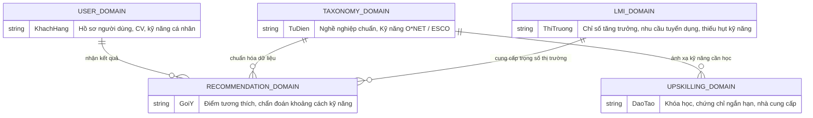

# Thiết kế cơ sở dữ liệu (Database Design Specification)

**Hệ quản trị CSDL:** PostgreSQL 16  
**Cơ chế ORM:** Spring Data JPA / Hibernate  
**Trạng thái thiết kế:** Cơ sở hạ tầng kết nối đã thiết lập — Lược đồ thực thể đang chờ phân tích chi tiết (Schema TBD)

---

## 1. Cơ sở hạ tầng kết nối hiện tại

Hệ thống đã cấu hình kết nối PostgreSQL chuẩn hóa qua biến môi trường thông qua [`backend/src/main/resources/application.yml`](file:///d:/Khai%20Van/KhaiVan%20Data/Dai%20Hoc/Skill--and-Labor-Market-Demand-Based-Career-Recommendation-System/backend/src/main/resources/application.yml):

* **Datasource URL:** `jdbc:postgresql://${POSTGRES_HOST:localhost}:${POSTGRES_PORT:5432}/${POSTGRES_DB:career_recommendation_db}`
* **Username / Password:** Tự động nạp qua `${POSTGRES_USER}` và `${POSTGRES_PASSWORD}`.
* **Driver:** `org.postgresql.Driver`
* **Hibernate Dialect:** `org.hibernate.dialect.PostgreSQLDialect`
* **Cơ chế triển khai:** Container hóa qua dịch vụ `postgres` trong [`docker-compose.yml`](file:///d:/Khai%20Van/KhaiVan%20Data/Dai%20Hoc/Skill--and-Labor-Market-Demand-Based-Career-Recommendation-System/docker-compose.yml), dữ liệu được lưu bền vững qua Docker volume `postgres_data`.

> [!NOTE]
> Mọi thông số kết nối và bí mật không bao giờ được hardcode vào mã nguồn. File [`.env.example`](file:///d:/Khai%20Van/KhaiVan%20Data/Dai%20Hoc/Skill--and-Labor-Market-Demand-Based-Career-Recommendation-System/.env.example) là mẫu chuẩn duy nhất được commit vào kho chứa.

---

## 2. Các miền dữ liệu dự kiến (Target Data Domains)

Dựa trên tài liệu khảo sát yêu cầu ([`docs/requirements/current-state.md`](file:///d:/Khai%20Van/KhaiVan%20Data/Dai%20Hoc/Skill--and-Labor-Market-Demand-Based-Career-Recommendation-System/docs/requirements/current-state.md)), hệ thống sẽ bao gồm 4 miền dữ liệu nghiệp vụ:

### Chi tiết các miền dữ liệu:
1. **Miền Hồ sơ người dùng (User Profile Domain):**
   * Lưu trữ tài khoản người dùng, thông tin cá nhân, CV tải lên, bộ kỹ năng đã bóc tách và chuẩn hóa, lịch sử tra cứu.
2. **Miền Phân loại chuẩn hóa (Occupational Taxonomy Domain):**
   * Lưu trữ danh mục nghề nghiệp (theo mã SOC / ISCO-08), từ điển kỹ năng chuẩn hóa (theo O\*NET hoặc ESCO), phân loại kỹ năng (cốt lõi, bổ trợ, kỹ năng chuyển đổi).
3. **Miền Dữ liệu thị trường lao động (Labor Market Information - LMI Domain):**
   * Dữ liệu thống kê việc làm, tốc độ tăng trưởng ngành, chỉ số khan hiếm kỹ năng (*skill shortages*), dữ liệu tin tuyển dụng đã khử trùng lặp.
4. **Miền Tài nguyên đào tạo (Upskilling & Course Domain):**
   * Danh mục khóa học, chứng chỉ ngắn hạn (*micro-credentials*), nhà cung cấp đào tạo và ánh xạ tương ứng tới các kỹ năng trong taxonomy.

---

## 3. Trạng thái các bảng CSDL chi tiết (Schema Status)

> [!IMPORTANT]
> **Trạng thái: `TBD` (To Be Decided — Chưa định nghĩa chi tiết).**  
> Tuân thủ nguyên tắc chống bịa đặt: Dự án **chưa** tạo bảng CSDL cụ thể hoặc các `@Entity` JPA giả định.  
> Các bảng dữ liệu chi tiết (tên bảng, kiểu dữ liệu từng cột, khóa chính, khóa ngoại, chỉ mục) sẽ được thiết kế và cập nhật vào file này trong phiên làm việc kế tiếp dành riêng cho thiết kế CSDL.

---

## 4. Quy ước thiết kế CSDL (Khi tiến hành thiết kế chi tiết)

Khi bắt đầu định nghĩa các bảng cụ thể, các AI agent phải tuân thủ nghiêm ngặt quy ước sau:
1. **Đặt tên bảng & cột:**
   * Tên bảng dùng chữ thường số nhiều, phân cách bằng dấu gạch dưới (`snake_case`), ví dụ: `users`, `skills`, `occupations`, `job_postings`.
   * Tên cột dùng chữ thường `snake_case`, ví dụ: `created_at`, `updated_at`, `user_id`.
   * Khóa chính chuẩn hóa là `id` (kiểu `BIGSERIAL` hoặc `UUID`).
2. **Khóa ngoại:**
   * Tên cột khóa ngoại có hậu tố `_id`, ví dụ: `user_id`, `occupation_id`.
   * Bắt buộc khai báo rõ ràng ràng buộc toàn vẹn tham chiếu (`ON DELETE RESTRICT` hoặc `CASCADE` tùy ngữ cảnh).
3. **Audit Fields:**
   * Mọi bảng thực thể chính phải có hai trường: `created_at TIMESTAMP WITH TIME ZONE DEFAULT CURRENT_TIMESTAMP` và `updated_at TIMESTAMP WITH TIME ZONE DEFAULT CURRENT_TIMESTAMP`.
4. **Quản lý Migration:**
   * Mọi thay đổi schema phải được thể hiện bằng file migration có phiên bản rõ ràng (sẽ lựa chọn giữa Flyway và Liquibase qua ADR).
