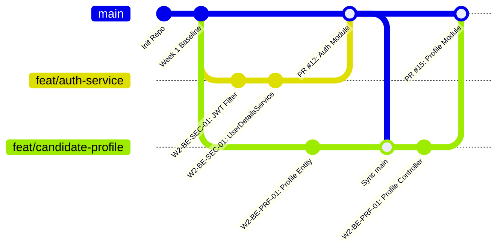

# Quy trình làm việc với Git & Kiểm soát mã nguồn (Git Workflow Specification)

**Mục đích:** Đảm bảo 06 thành viên trong nhóm có thể phát triển song song hiệu quả, tránh xung đột mã nguồn, duy trì tính toàn vẹn của nhánh chính (`main`) và bảo đảm khả năng kiểm soát phiên bản trong suốt 5 tuần phát triển.

---

## 1. Mô hình phân nhánh (Branching Strategy)

Dự án áp dụng mô hình **Trunk-Based Development kết hợp Short-lived Feature Branches**:



### Các quy tắc cốt lõi:
1. **Nhánh `main`:**
   * Là nhánh duy nhất đại diện cho mã nguồn có thể chạy được (Deployable State).
   * **Nghiêm cấm commit trực tiếp lên nhánh `main`.**
   * Mọi thay đổi đưa vào `main` bắt buộc phải thông qua **Pull Request (PR)**.
2. **Nhánh tính năng (Feature / Fix / Chore Branches):**
   * Được rẽ nhánh trực tiếp từ `main` mới nhất (`git checkout -b <branch-name> main`).
   * Vòng đời ngắn (tối đa 1–3 ngày làm việc), tương ứng với một Work Package hoặc Task ID trong [Sprint Backlog](file:///d:/Khai%20Van/KhaiVan%20Data/Dai%20Hoc/Skill--and-Labor-Market-Demand-Based-Career-Recommendation-System/docs/planning/week-2-5-backlog.md).

---

## 2. Quy ước đặt tên nhánh (Branch Naming Conventions)

Tên nhánh phải viết thường, phân cách bằng dấu gạch ngang (`kebab-case`), có tiền tố phân loại rõ ràng:

| Tiền tố | Mục đích sử dụng | Cú pháp mẫu | Ví dụ cụ thể |
| :--- | :--- | :--- | :--- |
| `feat/` | Phát triển tính năng mới | `feat/<task-id>-<slug-mo-ta>` | `feat/w2-be-sec-01-jwt-auth` |
| `fix/` | Sửa lỗi phần mềm | `fix/<bug-id>-<slug-mo-ta>` | `fix/bug-42-salary-range-validation` |
| `docs/` | Cập nhật tài liệu kỹ thuật | `docs/<slug-mo-ta>` | `docs/update-api-contract-admin` |
| `refactor/`| Cải tiến cấu trúc không đổi logic | `refactor/<slug-mo-ta>` | `refactor/recommendation-engine-query` |
| `test/` | Bổ sung unit/integration tests | `test/<slug-mo-ta>` | `test/profile-service-coverage` |
| `ops/` | Thay đổi Docker, Flyway, CI/CD | `ops/<slug-mo-ta>` | `ops/flyway-v2-seed-data` |

---

## 3. Quy chuẩn thông điệp Commit (Conventional Commits)

Mọi commit phải tuân thủ chuẩn **Conventional Commits 1.0**:

```text
<type>(<scope>): <mô tả ngắn gọn thì hiện tại>

[Mô tả chi tiết tùy chọn: nguyên nhân, giải pháp kỹ thuật, đánh đổi]

[Liên kết Task / Issue: ví dụ Closes #123 hoặc Ref W2-BE-SEC-01]
```

### Các kiểu Commit (`type`):
* `feat`: Thêm mới một tính năng hoặc API endpoint.
* `fix`: Sửa lỗi phát sinh.
* `docs`: Thêm hoặc chỉnh sửa tài liệu (`.md`).
* `style`: Chỉnh format mã nguồn (prettier, checkstyle), không ảnh hưởng logic.
* `refactor`: Tái cấu trúc mã nguồn.
* `test`: Thêm hoặc sửa đổi mã nguồn kiểm thử.
* `chore`: Cập nhật cấu hình build, thêm dependency, chỉnh `.gitignore`.

### Ví dụ hợp lệ:
```text
feat(auth): implement JWT token provider and authentication filter

- Add JwtTokenProvider with HMAC-SHA256 signature
- Register JwtAuthenticationFilter in SecurityFilterChain
- Configure public endpoints in application.yml

Ref: W2-BE-SEC-01
```

---

## 4. Quy trình tạo Pull Request & Tiêu chuẩn Phê duyệt (PR Checklist & Review)

### Các bước bắt buộc trước khi mở PR:
1. Đồng bộ mã mới nhất từ nhánh `main`:
   ```bash
   git checkout main
   git pull origin main
   git checkout <your-branch>
   git merge main  # hoặc git rebase main
   ```
2. Chạy toàn bộ bộ kiểm thử cục bộ:
   * Frontend: `npm run build` (kiểm tra TypeScript và bundle không lỗi).
   * Backend: `mvn clean test` (kiểm tra biên dịch và test cases vượt qua 100%).
3. Xác nhận working tree sạch sẽ, không vô tình đính kèm file tạm, `.env` hay file nhạy cảm.

### Mẫu kiểm tra Pull Request (PR Template Checklist):
```markdown
## Tóm tắt thay đổi (Summary)
- Mô tả các thay đổi chính trong PR này.
- Task ID liên quan: [W2-BE-...]

## Loại thay đổi (Type of Change)
- [ ] Tính năng mới (feat)
- [ ] Sửa lỗi (fix)
- [ ] Tái cấu trúc (refactor)
- [ ] Tài liệu (docs)

## Danh mục tự kiểm tra (Self-Checklist)
- [ ] Đã chạy `mvn clean test` thành công (0 failure, 0 error).
- [ ] Đã chạy `npm run build` thành công (0 TypeScript error).
- [ ] Đã cập nhật tài liệu liên quan trong `docs/` nếu thay đổi hợp đồng API hoặc CSDL.
- [ ] Không chứa mật khẩu, API key, token hoặc file `.env`.
- [ ] Không chứa file tạm rác IDE (`.idea/`, `.vscode/`, `*.class`).

## Người xét duyệt (Reviewers)
- Thành viên phụ trách domain liên quan: @...
- Nhóm trưởng (Tech Lead): @KhaiVan
```

### Quy định xét duyệt (Approval Policy):
* **Ít nhất 01 thành viên khác hoặc Tech Lead phê duyệt** trước khi gộp vào `main`.
* Mọi nhận xét (Review Comments) yêu cầu sửa đổi phải được giải quyết trước khi merge.
* Áp dụng phương thức **Squash and Merge** để giữ cho lịch sử nhánh `main` luôn tinh gọn và dễ truy vết.
