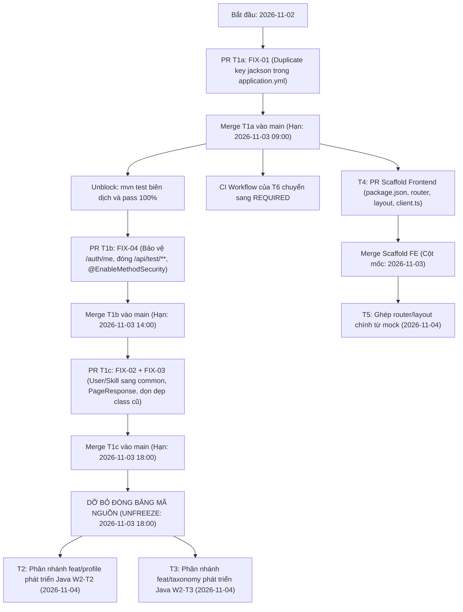

# Kế hoạch chi tiết Tác vụ Tuần 2 (Week 2 Sprint Plan & Task Assignment) — Phiên bản 2.1

**Dự án:** Hệ thống gợi ý nghề nghiệp dựa trên kỹ năng và nhu cầu thị trường lao động (Skill- and Labor Market Demand–Based Career Recommendation System)  
**Thời gian triển khai:** Tuần 2 (Sprint 2: Thứ Ba 2026-11-03 đến Chủ Nhật 2026-11-08; Ngày chuẩn bị: Thứ Hai 2026-11-02)  
**Quy mô đội ngũ:** 06 thành viên (Bùi Vạn Khải, Phạm Ngọc Gia Khang, Huỳnh Long Bảo Khanh, Lương Phúc Khang, Đoàn Việt Khang, Phan Nguyễn Thông)  
**Mục tiêu Sprint:**
1. Thực thi chuỗi kiểm soát cổng (Gate Sequence) giải quyết dứt điểm các lỗi nền tảng Tuần 1 (YAML syntax, hợp nhất thực thể, đóng bảo mật endpoint).
2. Xây dựng dịch vụ nghiệp vụ cốt lõi: Hồ sơ ứng viên (Profile) và Danh mục Nghề nghiệp/Kỹ năng chuẩn hóa (Taxonomy) kèm dữ liệu mẫu Seed Data O*NET V3.
3. Thiết lập bộ khung Frontend hoàn chỉnh với định tuyến động không xung đột (`import.meta.glob`), quản lý phiên JWT qua AuthContext và giao diện tra cứu nghề nghiệp với biểu đồ SVG/CSS thuần.
4. Chuẩn hóa hạ tầng Docker Compose một chạm và kích hoạt pipeline CI tự động trên GitHub Actions.

---

## 1. Lệnh Đóng băng Mã nguồn & Chuỗi Kiểm soát Cổng W2-T1 (Code Freeze & Gate Sequence)

Do tác vụ **W2-T1 (Bùi Vạn Khải)** nắm giữ các bản sửa lỗi cốt lõi (block việc chạy test của T2, T3 và workflow CI của T6), toàn bộ đội ngũ phải tuân thủ nghiêm ngặt chuỗi kiểm soát cổng sau:



### 1.1. Lệnh Đóng băng Mã nguồn & Ngoại lệ T1c (Code Freeze Notice & T1c Import Exception)
> [!CAUTION]
> **LỆNH ĐÓNG BĂNG MÃ NGUỒN (CODE FREEZE):**  
> Trong ngày đầu tiên của Tuần 2 (2026-11-03), cho đến khi PR **`T1c`** được merge chính thức vào nhánh `main` (trước 18:00 2026-11-03), **TUYỆT ĐỐI CẤM** các thành viên khác chỉnh sửa hoặc tạo mới file trong các thư mục sau:
> - `backend/src/main/java/com/cnpm/careerrecommendation/entity/`
> - `backend/src/main/java/com/cnpm/careerrecommendation/repository/`
> - `backend/src/main/java/com/cnpm/careerrecommendation/exception/`
> - `backend/src/main/java/com/cnpm/careerrecommendation/dto/`
> - `backend/src/main/java/com/cnpm/careerrecommendation/module/auth/entity/`
>
> Toàn bộ nhánh tính năng Java của **T2 (Phạm Ngọc Gia Khang)** và **T3 (Huỳnh Long Bảo Khanh)** chỉ được phép phân nhánh (branch out) từ `main` **SAU KHI PR T1c ĐÃ MERGE**.

> [!NOTE]
> **NGOẠI LỆ ĐẶC BIỆT CHO PR T1c (T1c Import Exception):**  
> Nhằm dọn dẹp các import hỏng khi di chuyển `Skill`, `SkillCategory` sang `common.entity.*` và xóa các DTO/Exception phẳng cũ, **PR T1c được phép duy nhất chỉnh sửa các câu lệnh `import` (import statements only)** trong các file thực thể sau trước khi T2/T3 phân nhánh:
> - `backend/src/main/java/com/cnpm/careerrecommendation/entity/CandidateProfile.java`
> - `backend/src/main/java/com/cnpm/careerrecommendation/entity/UserSkill.java`
> - `backend/src/main/java/com/cnpm/careerrecommendation/entity/OccupationGroup.java`
> - `backend/src/main/java/com/cnpm/careerrecommendation/entity/Occupation.java`
> - `backend/src/main/java/com/cnpm/careerrecommendation/entity/OccupationSkill.java`
> - `backend/src/main/java/com/cnpm/careerrecommendation/entity/MarketDemandIndicator.java`
> 
> T1c **tuyệt đối không chỉnh sửa** cấu trúc trường, quan hệ `@OneToMany`, `@ManyToOne` hay logic nghiệp vụ của các entity này.  
> **Hoạt động song song trong thời gian đóng băng:**
> - **T3 (Huỳnh Long Bảo Khanh):** Có thể viết độc lập file SQL migration `V3__seed_taxonomy_and_occupations.sql` và chuẩn bị bộ dữ liệu O*NET / LMI.
> - **T2 (Phạm Ngọc Gia Khang):** Có thể viết trước các DTOs (`ProfileResponse`, `UpdateProfileRequest`) và tài liệu kế hoạch kiểm thử test plan.

### 1.2. Phân rã 3 PR tuần tự của W2-T1
1. **PR T1a (FIX-01 — Merge trước 2026-11-03 09:00):** Sửa lỗi duplicate key `jackson` tại `backend/src/main/resources/application.yml`. Khôi phục lệnh `mvn -f backend/pom.xml test` chạy pass ngay lập tức. Sau khi T1a merge, workflow CI của T6 chính thức chuyển thành kiểm tra bắt buộc (Required status check).
2. **PR T1b (FIX-04 — Hạn: 2026-11-03 14:00):** Sửa quy tắc `SecurityConfig.java` yêu cầu xác thực đối với `GET /api/v1/auth/me`, đóng đường dẫn thử nghiệm `/api/test/**`, bật `@EnableMethodSecurity(prePostEnabled = true)`.
3. **PR T1c (FIX-02 + FIX-03 — Hạn: 2026-11-03 18:00 -> UNFREEZE):** 
   - Di chuyển và chuẩn hóa `User` thành `com.cnpm.careerrecommendation.common.entity.User` (có cột `phone` từ V2, kiểu ngày giờ chuẩn).
   - Di chuyển `Skill` và `SkillCategory` sang `com.cnpm.careerrecommendation.common.entity.*` và `com.cnpm.careerrecommendation.common.repository.*` để cả Profile (T2) và Taxonomy (T3) đều sử dụng mà không phụ thuộc chéo vào nhau.
   - Tạo DTO dùng chung `PageResponse<T>` tại `com.cnpm.careerrecommendation.common.dto.PageResponse`.
   - Xóa bỏ các package phẳng trùng lặp (`exception/`, `dto/`, `entity/User.java`, `repository/UserRepository.java`). Cập nhật các test cũ tương ứng.

### 1.3. Cột mốc Ngày 1 cho Frontend (Day-1 Frontend Scaffold Milestone: 2026-11-03)
* **Lương Phúc Khang (W2-T4)** phải hoàn thành và merge **Scaffold PR** trong Ngày 1 (2026-11-03), bao gồm: `package.json` (cài `react-router-dom`, `axios`), `frontend/src/api/client.ts`, bộ định tuyến động `index.tsx`, `CandidateLayout`, `AdminLayout` và `AuthContext`.
* Trong thời gian chờ T4 merge Scaffold PR, **Đoàn Việt Khang (W2-T5)** làm việc hoàn toàn độc lập trên nhánh riêng với dữ liệu giả lập đặt tại `frontend/src/features/occupations/mocks/`.

---

## 2. Bảng phân công 08 Tác vụ Tuần 2 (Reassigned Task Sheet & Schedule)

> [!NOTE]
> **Hạn chót Sprint:**
> - Toàn bộ các tác vụ phát triển W2-T1 đến W2-T6 có hạn hoàn thành muộn nhất là **Thứ Sáu 2026-11-06 (End of Day)**.
> - **Thứ Bảy 2026-11-07:** Dành toàn bộ thời gian cho Tích hợp Hệ thống (End-to-End Integration Testing) và sửa lỗi buffer.
> - **Chủ Nhật 2026-11-08:** Đánh giá Sprint (Sprint Review), nghiệm thu DoD và đóng Sprint 2.

| ID | Tên task | Người phụ trách | Ưu tiên | Trạng thái ban đầu | Ngày bắt đầu | Hạn hoàn thành | Chặn bởi | Phụ thuộc & Điều phối | Tài liệu nguồn | Mã yêu cầu chuẩn | Tiêu chí nghiệm thu đo lường được (DoD) |
| :---: | :--- | :---: | :---: | :---: | :---: | :---: | :---: | :--- | :--- | :---: | :--- |
| **W2-T1a** | Khắc phục Duplicate Key Jackson trong application.yml (FIX-01) | **Bùi Vạn Khải** (Tech Lead) | P0 (Gate) | Sẵn sàng | 2026-11-02 | 2026-11-03 09:00 | Không | Độc lập. Mở khóa cho việc biên dịch và chạy test toàn dự án. CI T6 chuyển sang Required. | - `docs/audit/week1-audit.md`<br/>- `docs/plan/week2-tasks.md` | `NFR-08`<br/>`NFR-09` | 1. `mvn -f backend/pom.xml test-compile` thành công.<br/>2. Không còn cảnh báo duplicate key trong `application.yml`.<br/>3. PR được merge vào `main` trước 09:00 2026-11-03. |
| **W2-T1b** | Chuẩn hóa Phân quyền & Đóng Bảo mật Endpoint (FIX-04) | **Bùi Vạn Khải** (Tech Lead) | P0 (Gate) | Sẵn sàng | 2026-11-03 | 2026-11-03 14:00 | W2-T1a | Yêu cầu auth cho `/api/v1/auth/me`, đóng `/api/test/**`, bật `@EnableMethodSecurity`. | - `docs/adr/ADR-0006`<br/>- `docs/api/api-contract.md` | `FR-03`<br/>`NFR-01`<br/>`UC-03` | 1. `GET /api/v1/auth/me` không có token trả HTTP 401 với `ErrorResponse` chuẩn.<br/>2. Đường dẫn `/api/test/**` bị đóng hoàn toàn.<br/>3. `@EnableMethodSecurity(prePostEnabled = true)` hoạt động trên controller. |
| **W2-T1c** | Hợp nhất Thực thể User, Skill sang Common & Chuẩn hóa DTO (FIX-02, 03) | **Bùi Vạn Khải** (Tech Lead) | P0 (Gate) | Chờ T1b | 2026-11-03 | 2026-11-03 18:00 | W2-T1b | Di chuyển `User`, `Skill`, `SkillCategory` sang `common.*`. Tạo `PageResponse`. Dọn dẹp package phẳng. DỠ BỎ ĐÓNG BĂNG MÃ NGUỒN. | - `docs/adr/ADR-0004`<br/>- `docs/adr/ADR-0005`<br/>- `docs/api/api-contract.md` | `FR-01`<br/>`NFR-05`<br/>`UC-01`<br/>`UC-25` | 1. `mvn -f backend/pom.xml test` thoát mã 0, 0 failures, 0 errors.<br/>2. 9 file test hiện hữu tại `backend/src/test/**` chạy pass 100%.<br/>3. Xóa sạch các class phẳng trùng lặp.<br/>4. PR merge trước 18:00 2026-11-03. |
| **W2-T2** | Hiện thực hóa Dịch vụ & REST API Hồ sơ Ứng viên và Kỹ năng cá nhân | **Phạm Ngọc Gia Khang** (Backend Dev) | P1 | Chờ Gate T1c | 2026-11-04 | 2026-11-06 | W2-T1c | Bắt đầu sau khi T1c merge. Import `User` và `Skill` từ `common`. Không import từ `module.taxonomy`. Tự tạo fixture test riêng, không phụ thuộc V3. | - `docs/api/profile.md`<br/>- `docs/database/database-design.md`<br/>- `docs/adr/ADR-0005` | `FR-05`<br/>`FR-07`<br/>`FR-08`<br/>`UC-06`<br/>`UC-08`<br/>`UC-11` | 1. Khi chưa có hồ sơ, `GET /api/v1/profile` trả HTTP 404 với mã `PROFILE_NOT_FOUND`.<br/>2. `PUT /api/v1/profile` cập nhật thành công, validate `salaryMin <= salaryMax`.<br/>3. `POST /api/v1/profile/skills` thêm kỹ năng thành công; validate từ chối kỹ năng không tồn tại.<br/>4. Tối thiểu 10 ca kiểm thử tự động tại `module/profile` pass 100%, 0 failure. |
| **W2-T3** | Hiện thực hóa Dịch vụ Danh mục Nghề nghiệp, Kỹ năng & Nạp Seed Data V3 | **Huỳnh Long Bảo Khanh** (Backend Dev) | P1 | Chờ Gate T1c | 2026-11-03 (SQL) / 2026-11-04 (Java) | 2026-11-06 | W2-T1c | Viết trước SQL V3 ngày 11-03; code Java sau khi T1c merge. Sở hữu độc quyền Flyway `V3`. Cung cấp API công khai cho Frontend T5. | - `docs/api/taxonomy.md`<br/>- `docs/database/database-design.md`<br/>- `docs/adr/ADR-0007` | `FR-11`<br/>`FR-12`<br/>`FR-13`<br/>`FR-21`<br/>`UC-12`<br/>`UC-13`<br/>`UC-14`<br/>`UC-26` | 1. Migration `V3` thực thi sạch sẽ qua Flyway không lỗi SQL syntax.<br/>2. `GET /api/v1/occupations` trả về danh sách >=10 nghề CNTT kèm phân trang `PageResponse`.<br/>3. `GET /api/v1/occupations/{id}` trả về chi tiết nghề kèm kỹ năng và chỉ số LMI.<br/>4. Tối thiểu 8 ca kiểm thử tự động tại `module/taxonomy` pass 100%, 0 failure. |
| **W2-T4** | Thiết lập Khung Frontend, Router Động, Luồng Auth JWT & Layout Ứng viên | **Lương Phúc Khang** (Frontend Dev) | P1 (Milestone) | Sẵn sàng | 2026-11-03 | 2026-11-05 | Không | Cung cấp Scaffold PR trong Ngày 1 (2026-11-03) cho T5. Quản trị cấu hình build frontend, Axios client, AuthContext, ProtectedRoute theo prop `roles`. | - `docs/architecture/system-architecture.md`<br/>- `docs/adr/ADR-0008` | `FR-01`<br/>`FR-02`<br/>`FR-03`<br/>`NFR-01`<br/>`UC-01`<br/>`UC-02`<br/>`UC-03`<br/>`UC-04` | 1. Hoàn thành merge Scaffold PR trong Ngày 1 (2026-11-03).<br/>2. `npm run build` tại `frontend/` chạy `tsc -b && vite build` thành công, mã thoát 0.<br/>3. Đăng nhập/đăng ký hoạt động mượt mà, lưu token và hiển thị tên người dùng trên Header.<br/>4. `ProtectedRoute` chặn thành công người dùng chưa đăng nhập hoặc sai vai trò qua prop `roles`. |
| **W2-T5** | Xây dựng Giao diện Khám phá Nghề nghiệp & Biểu đồ LMI bằng Plain SVG/CSS | **Đoàn Việt Khang** (Frontend Dev) | P1 | Sẵn sàng | 2026-11-03 (mock) / 2026-11-04 (ghép) | 2026-11-06 | W2-T4 (Scaffold) | Ngày 11-03 phát triển với mock tại `mocks/`. Ngày 11-04 ghép vào router của T4. Ngày 11-05 kết nối API thực của T3. Biểu đồ bằng Plain SVG/CSS thuần. | - `docs/api/taxonomy.md`<br/>- `docs/development/coding-conventions.md`<br/>- `docs/adr/ADR-0008` | `FR-11`<br/>`FR-12`<br/>`FR-13`<br/>`UC-12`<br/>`UC-13`<br/>`UC-14` | 1. Trang `/occupations` và `/occupations/:id` hiển thị giao diện chuẩn responsive trên Desktop & Mobile.<br/>2. Tìm kiếm và phân trang hoạt động mượt mà.<br/>3. Biểu đồ nhu cầu LMI hiển thị trực quan bằng SVG/CSS thuần không phát sinh lỗi render.<br/>4. File `occupationsRoutes.tsx` được tự động nhận diện qua glob mà không cần sửa router chính của T4. |
| **W2-T6** | Chuẩn hóa Môi trường Docker Compose, Biến Môi trường & Thiết lập CI Pipeline | **Phan Nguyễn Thông** (DevOps / QA) | P1 | Sẵn sàng | 2026-11-03 | 2026-11-06 | W2-T1a | Khởi tạo CI workflow non-required ngày 11-03; chuyển thành Required ngay sau T1a merge. Sở hữu `backend/pom.xml`, Dockerfiles, `docker-compose.yml`, scripts. | - `docs/architecture/system-architecture.md`<br/>- `docs/adr/ADR-0009` | `NFR-08`<br/>`NFR-09`<br/>`NFR-10`<br/>`NFR-13` | 1. Chạy script `init-env.ps1` tạo file `.env` chuẩn xác, sinh `JWT_SECRET` hợp lệ không chứa tiền tố `your_`.<br/>2. Lệnh `docker compose config` chạy thành công không cảnh báo missing variable.<br/>3. Khởi chạy `docker compose up -d` liên thông 3 container đều đạt trạng thái `healthy` / `running`.<br/>4. GitHub Actions CI workflow chạy pass cả Backend unit test, Integration test và Frontend build. |

---

## 3. Ma trận Phụ thuộc và Ngăn ngừa Xung đột Git (Refined Conflict Matrix)

Ma trận dưới đây loại bỏ triệt để các nhận định "độc lập tuyệt đối" giả tạo, chỉ rõ điểm chia sẻ tài nguyên và cơ chế giảm thiểu xung đột:

| Tác vụ | W2-T1 (Bùi Vạn Khải) | W2-T2 (Phạm Ngọc Gia Khang) | W2-T3 (Huỳnh Long Bảo Khanh) | W2-T4 (Lương Phúc Khang) | W2-T5 (Đoàn Việt Khang) | W2-T6 (Phan Nguyễn Thông) |
| :---: | :---: | :---: | :---: | :---: | :---: | :---: |
| **W2-T1**<br/>(Security & Core) | **CHỦ THỂ** | **Điểm giao thoa:** T2 dùng `User`, `Skill`, `AuthenticatedUser`.<br/>**Giải pháp:** T1 cung cấp qua `common.*` trong PR T1c. T2 bị đóng băng đến khi T1c merge. | **Điểm giao thoa:** T3 dùng `Skill`, `SkillCategory`, `PageResponse`.<br/>**Giải pháp:** T1 đưa vào `common.*` trong PR T1c. T3 bị đóng băng code Java đến khi T1c merge. | **Điểm giao thoa:** Hợp đồng API Auth (`/api/v1/auth/**`).<br/>**Giải pháp:** T1 độc quyền sở hữu `api-contract.md` và mã nguồn Auth backend; T4 tiêu thụ API qua Axios. | **Ranh giới:** Backend Java vs Frontend TypeScript. Không chạm chung file. | **Điểm giao thoa:** Cấu hình biến môi trường và healthcheck.<br/>**Giải pháp:** T1 sở hữu `application.yml`; T6 sở hữu `docker-compose.yml`, `backend/pom.xml` và script `.env`. |
| **W2-T2**<br/>(Profile Backend) | Kế thừa từ T1c | **CHỦ THỂ** | **ĐIỂM GIAO THOA SKILL & TAXONOMY:** Cả hai cùng làm việc với kỹ năng.<br/>**Giải pháp:** Không độc lập tuyệt đối. `Skill` và `SkillCategory` được đưa vào `common.entity`. T2 **tuyệt đối không** import từ `module.taxonomy`. T2 tự tạo mock fixture trong test, không phụ thuộc Seed Data V3 của T3. | **Điểm giao thoa:** Hợp đồng API Profile.<br/>**Giải pháp:** T2 độc quyền sở hữu `docs/api/profile.md`; T4 làm việc với Mock JSON nếu cần hiển thị thông tin ứng viên. | **Ranh giới:** Backend vs Frontend. Không chạm chung file. | **Độc lập:** T2 không chỉnh sửa cấu hình Docker hay workflow CI của T6. |
| **W2-T3**<br/>(Taxonomy Backend) | Kế thừa từ T1c | Tách biệt qua `common.entity.Skill` | **CHỦ THỂ**<br/>(Sở hữu độc quyền Flyway `V3` và `docs/api/taxonomy.md`) | **Ranh giới:** Backend vs Frontend. Không chạm chung file. | **Điểm giao thoa:** Hợp đồng API Occupations.<br/>**Giải pháp:** T3 cung cấp API thực theo `taxonomy.md`. T5 phát triển bằng Mock trong ngày đầu, sau đó chuyển sang gọi API thực của T3. | **Điểm giao thoa:** Migration V3.<br/>**Giải pháp:** T3 độc quyền tạo `V3__seed_...`. T6 không viết file migration nào. |
| **W2-T4**<br/>(Frontend Core) | Ranh giới API Auth | Ranh giới API Profile | Độc lập | **CHỦ THỂ**<br/>(Sở hữu độc quyền Scaffold, router chính, layouts) | **ĐIỂM GIAO THOA FRONTEND:** Tránh xung đột tại Router và Layout.<br/>**Giải pháp:** T4 dùng `import.meta.glob` tự động nạp routes. T4 merge Scaffold PR trong Ngày 1 (2026-11-03). T5 chỉ viết route con tại `occupationsRoutes.tsx`, không sửa router cha. | **Điểm giao thoa:** Build & Dockerize Frontend.<br/>**Giải pháp:** T4 quản lý code nguồn; T6 quản lý `Dockerfile` và `nginx.conf`. |
| **W2-T5**<br/>(Frontend Discovery) | Ranh giới API | Ranh giới API | Tiêu thụ API của T3 | Kế thừa Scaffold PR từ T4 | **CHỦ THỂ**<br/>(Sở hữu độc quyền `features/occupations/**`, `components/common/**`) | **Độc lập:** T5 không sửa file cấu hình Docker hay CI. |
| **W2-T6**<br/>(DevOps & CI) | Ranh giới config | Độc lập | Độc lập | Độc lập | Độc lập | **CHỦ THỂ**<br/>(Sở hữu độc quyền `.github/**`, `docker-compose.yml`, `scripts/**`, `backend/pom.xml`) |

---

## 4. Danh mục Sở hữu Đường dẫn Độc quyền (Single Ownership File Registry)

Mỗi đường dẫn tệp mã nguồn và cấu hình trong repository được phân bổ duy nhất cho **chính xác một chủ sở hữu**. Không có bất kỳ tệp nào có từ hai chủ sở hữu trở lên.

### 4.1. Danh mục phân bổ chi tiết theo Tác vụ

* **W2-T1 (Bùi Vạn Khải):**
  - `backend/src/main/resources/application.yml`
  - `backend/src/main/java/com/cnpm/careerrecommendation/config/**` *(gồm `SecurityConfig.java`, `WebMvcConfig.java`, `CorsProperties.java`, `package-info.java`)*
  - `backend/src/main/java/com/cnpm/careerrecommendation/controller/**` *(gồm `HealthController.java`, `package-info.java`)*
  - `backend/src/main/java/com/cnpm/careerrecommendation/CareerRecommendationApplication.java`
  - `backend/src/main/java/com/cnpm/careerrecommendation/common/**` *(chứa `common.entity.User`, `Skill`, `SkillCategory`, `PageResponse`, `ErrorResponse`, `GlobalExceptionHandler`, security filters)*
  - `backend/src/main/java/com/cnpm/careerrecommendation/module/auth/**` *(chứa `AuthController`, `AuthService`, DTOs, tests của Auth)*
  - `backend/src/main/java/com/cnpm/careerrecommendation/entity/User.java` *(xóa trong T1c)*
  - `backend/src/main/java/com/cnpm/careerrecommendation/entity/Skill.java` *(di chuyển sang common trong T1c)*
  - `backend/src/main/java/com/cnpm/careerrecommendation/entity/SkillCategory.java` *(di chuyển sang common trong T1c)*
  - `backend/src/main/java/com/cnpm/careerrecommendation/entity/RecommendationLog.java`
  - `backend/src/main/java/com/cnpm/careerrecommendation/entity/package-info.java`
  - `backend/src/main/java/com/cnpm/careerrecommendation/repository/UserRepository.java` *(xóa trong T1c)*
  - `backend/src/main/java/com/cnpm/careerrecommendation/repository/SkillRepository.java` *(di chuyển sang common trong T1c)*
  - `backend/src/main/java/com/cnpm/careerrecommendation/repository/SkillCategoryRepository.java` *(di chuyển sang common trong T1c)*
  - `backend/src/main/java/com/cnpm/careerrecommendation/repository/RecommendationLogRepository.java`
  - `backend/src/main/java/com/cnpm/careerrecommendation/repository/package-info.java`
  - `backend/src/main/java/com/cnpm/careerrecommendation/dto/**` *(xóa các DTO phẳng cũ trong T1c)*
  - `backend/src/main/java/com/cnpm/careerrecommendation/exception/**` *(xóa handler phẳng cũ trong T1c)*
  - `backend/src/main/java/com/cnpm/careerrecommendation/service/package-info.java`
  - `backend/src/test/java/com/cnpm/careerrecommendation/CareerRecommendationApplicationTests.java`
  - `backend/src/test/java/com/cnpm/careerrecommendation/common/**` *(chứa `JwtTokenProviderTest.java`)*
  - `backend/src/test/java/com/cnpm/careerrecommendation/config/**` *(chứa `CorsConfigTest.java`)*
  - `backend/src/test/java/com/cnpm/careerrecommendation/controller/**` *(chứa `HealthControllerTest.java`)*
  - `backend/src/test/java/com/cnpm/careerrecommendation/entity/**` *(chứa `EntityMappingTest.java`, `HibernateMetadataTest.java`)*
  - `backend/src/test/java/com/cnpm/careerrecommendation/exception/**` *(chứa `GlobalExceptionHandlerTest.java`)*
  - `backend/src/test/java/com/cnpm/careerrecommendation/module/auth/**` *(chứa `AuthPostgresIT.java`, `AuthRequestValidationTest.java`)*
  - `docs/api/api-contract.md` *(độc quyền quản lý hợp đồng tổng thể & auth)*

* **W2-T2 (Phạm Ngọc Gia Khang):**
  - `backend/src/main/java/com/cnpm/careerrecommendation/entity/CandidateProfile.java`
  - `backend/src/main/java/com/cnpm/careerrecommendation/entity/UserSkill.java`
  - `backend/src/main/java/com/cnpm/careerrecommendation/repository/CandidateProfileRepository.java`
  - `backend/src/main/java/com/cnpm/careerrecommendation/repository/UserSkillRepository.java`
  - `backend/src/main/java/com/cnpm/careerrecommendation/module/profile/**`
  - `backend/src/test/java/com/cnpm/careerrecommendation/module/profile/**`
  - `docs/api/profile.md` *(độc quyền quản lý hợp đồng API profile)*

* **W2-T3 (Huỳnh Long Bảo Khanh):**
  - `backend/src/main/resources/db/migration/V3__seed_taxonomy_and_occupations.sql`
  - `backend/src/main/java/com/cnpm/careerrecommendation/entity/OccupationGroup.java`
  - `backend/src/main/java/com/cnpm/careerrecommendation/entity/Occupation.java`
  - `backend/src/main/java/com/cnpm/careerrecommendation/entity/OccupationSkill.java`
  - `backend/src/main/java/com/cnpm/careerrecommendation/entity/MarketDemandIndicator.java`
  - `backend/src/main/java/com/cnpm/careerrecommendation/repository/OccupationGroupRepository.java`
  - `backend/src/main/java/com/cnpm/careerrecommendation/repository/OccupationRepository.java`
  - `backend/src/main/java/com/cnpm/careerrecommendation/repository/OccupationSkillRepository.java`
  - `backend/src/main/java/com/cnpm/careerrecommendation/repository/MarketDemandIndicatorRepository.java`
  - `backend/src/main/java/com/cnpm/careerrecommendation/module/taxonomy/**`
  - `backend/src/test/java/com/cnpm/careerrecommendation/module/taxonomy/**`
  - `docs/api/taxonomy.md` *(độc quyền quản lý hợp đồng API taxonomy)*

* **W2-T4 (Lương Phúc Khang):**
  - `frontend/package.json`
  - `frontend/package-lock.json`
  - `frontend/vite.config.ts`
  - `frontend/tsconfig*.json` *(gồm `tsconfig.json`, `tsconfig.app.json`, `tsconfig.node.json`)*
  - `frontend/index.html`
  - `frontend/eslint.config.*`
  - `frontend/public/**` *(chứa `vite.svg`)*
  - `frontend/src/main.tsx`
  - `frontend/src/App.tsx`
  - `frontend/src/App.css`
  - `frontend/src/index.css`
  - `frontend/src/vite-env.d.ts`
  - `frontend/src/api/**` *(chứa `client.ts`)*
  - `frontend/src/context/**` *(chứa `AuthContext.tsx`)*
  - `frontend/src/routes/**` *(chứa `index.tsx` nạp route tự động, `ProtectedRoute.tsx`)*
  - `frontend/src/layouts/**` *(chứa `CandidateLayout.tsx`, `AdminLayout.tsx`)*
  - `frontend/src/features/auth/**` *(chứa `LoginPage.tsx`, `RegisterPage.tsx`)*
  - `frontend/src/styles/**` *(chứa CSS Variables)*

* **W2-T5 (Đoàn Việt Khang):**
  - `frontend/src/features/occupations/**` *(chứa `occupationsRoutes.tsx`, trang danh sách, trang chi tiết, biểu đồ LMI bằng Plain SVG/CSS, thư mục `mocks/`)*
  - `frontend/src/features/admin/**` *(chứa stub giao diện quản trị)*
  - `frontend/src/components/common/**` *(chứa `Card`, `Badge`, `SearchBar`, `PaginationControl`, `Spinner`)*

* **W2-T6 (Phan Nguyễn Thông):**
  - `backend/pom.xml` *(quản lý dependencies, plugin failsafe và profile `postgres-it` đã có sẵn tại dòng 106-117)*
  - `.gitignore`
  - `README.md`
  - `docker-compose.yml`
  - `backend/Dockerfile`
  - `backend/.dockerignore`
  - `frontend/Dockerfile`
  - `frontend/.dockerignore`
  - `frontend/nginx.conf`
  - `docker/**`
  - `.env.example`
  - `scripts/**` *(chứa `init-env.ps1`, `init-env.sh`, `test-auth.ps1`)*
  - `.github/**` *(chứa `.github/workflows/ci.yml`)*
  - `docs/development/README.md`

### 4.2. Danh mục Tệp Cơ sở Bất biến & Tài liệu Lịch sử (Immutable Baselines & Historical Leftovers)

> [!IMPORTANT]
> **Các tệp bất biến (Read-only / Immutable Baselines):**  
> - `backend/src/main/resources/db/migration/V1__initial_schema.sql` (Baseline DDL Tuần 1 — **CẤM SỬA**)
> - `backend/src/main/resources/db/migration/V2__auth_phone_and_email_uniqueness.sql` (Baseline V2 Tuần 1 — **CẤM SỬA**)
> - `AI_RULES.md`, `LICENSE` (Quy ước bắt buộc của kho mã nguồn)

Kết quả thực thi kiểm tra trừ tập hợp các mẫu đường dẫn sở hữu tác vụ (`owned globs`) khỏi toàn bộ 131 tệp đang được Git theo dõi (`git ls-files`) cho kết quả còn lại **chính xác 37 tệp** tài liệu lịch sử / quy ước chung bất biến sau:
```text
AI_RULES.md
LICENSE
backend/src/main/resources/db/migration/V1__initial_schema.sql
backend/src/main/resources/db/migration/V2__auth_phone_and_email_uniqueness.sql
docs/README.md
docs/api/README.md
docs/architecture/README.md
docs/architecture/system-architecture.md
docs/database/README.md
docs/database/database-design.md
docs/decisions/ADR-0001-baseline-tech-stack.md
docs/decisions/ADR-0002-database-migration-tool.md
docs/decisions/ADR-0003-auth-contract-alignment.md
docs/decisions/ADR-TEMPLATE.md
docs/decisions/README.md
docs/development/coding-conventions.md
docs/development/git-workflow.md
docs/development/w1-t5-auth-guide.md
docs/devlogs/2026-10-09-init-ai-rules-and-docs.md
docs/devlogs/2026-10-22-resolve-week-1-task-1.md
docs/devlogs/2026-10-23-week-1-decisions-and-task-mapping.md
docs/devlogs/2026-10-29-w1-t3-backend-foundation.md
docs/devlogs/2026-10-29-w1-t4-jpa-entities-and-repositories.md
docs/devlogs/2026-10-29-w1-t5-jwt-auth-viet-khang.md
docs/devlogs/2026-10-30-w1-t6-docker-compose.md
docs/devlogs/DEVLOG-TEMPLATE.md
docs/devlogs/README.md
docs/planning/README.md
docs/planning/week-2-5-backlog.md
docs/project-overview.md
docs/requirements/README.md
docs/requirements/actors-and-use-cases.md
docs/requirements/current-state.md
docs/research/README.md
docs/research/research-overview.md
docs/research/research-platforms-and-problems.md
docs/research/research-skill-gap-esco.md
```
Tất cả các tệp này đều thuộc lớp tài liệu nền tảng hoặc nhật ký tuần trước, **không có bất kỳ tệp mã nguồn nào bị bỏ sót hay chồng lấn chủ sở hữu**.

---

## 5. Quy chuẩn Kỹ thuật Bổ sung & Hợp đồng Tích hợp Tuần 2

### 5.1. Đặc tả Hợp đồng Hồ sơ Ứng viên khi Chưa có Hồ sơ (`GET /api/v1/profile`)
Nhằm tuân thủ nguyên tắc phi tác dụng phụ (no side-effects) của phương thức HTTP GET:
* Khi ứng viên mới đăng ký gọi `GET /api/v1/profile`, backend **KHÔNG TỰ ĐỘNG TẠO HỒ SƠ RỖNG** trong CSDL.
* Backend trả về mã trạng thái **HTTP 404 Not Found** với cấu trúc `ErrorResponse` chuẩn:
  ```json
  {
    "timestamp": "2026-11-03T10:15:30Z",
    "status": 404,
    "error": "Not Found",
    "message": "Hồ sơ ứng viên chưa được khởi tạo. Vui lòng cập nhật thông tin hồ sơ lần đầu qua PUT /api/v1/profile",
    "path": "/api/v1/profile",
    "errors": []
  }
  ```
* Người dùng khởi tạo hồ sơ lần đầu bằng cách gửi yêu cầu `PUT /api/v1/profile` kèm các thông tin nguyện vọng.

### 5.2. Cơ chế Nạp Định tuyến Động Phía Frontend (`import.meta.glob`) & Quy chuẩn `handle`
Để loại bỏ hoàn toàn việc chỉnh sửa chung file định tuyến:
* Lương Phúc Khang (W2-T4) thiết lập `frontend/src/routes/index.tsx` sử dụng tính năng nạp module tự động của Vite kết hợp `AppRouteHandle`:
  ```typescript
  import { createBrowserRouter } from 'react-router-dom';
  import type { RouteObject } from 'react-router-dom';

  export interface AppRouteHandle {
    layout: 'candidate' | 'admin' | 'public';
    roles?: ('ROLE_CANDIDATE' | 'ROLE_ADMIN')[];
  }

  // Tự động quét toàn bộ các file *Routes.tsx trong thư mục features/*/
  const featureRouteModules = import.meta.glob<{ default: RouteObject[] }>(
    '../features/*/*Routes.tsx',
    { eager: true }
  );

  const featureRoutes: RouteObject[] = Object.values(featureRouteModules).flatMap(
    (mod) => mod.default || []
  );
  ```
* **Quy chuẩn trang Khám phá Nghề nghiệp (`/occupations`):**
  * Trang `/occupations` và `/occupations/:id` là **HOÀN TOÀN CÔNG KHAI (Public)**:
    `handle: { layout: 'candidate', roles: [] }` (hoặc `roles` undefined).
  * Khách vãng lai, ứng viên chưa đăng nhập hoặc đã đăng nhập đều có thể truy cập tự do mà không bị chặn.
* Đoàn Việt Khang (W2-T5) chỉ cần tạo file `frontend/src/features/occupations/occupationsRoutes.tsx` xuất khẩu mặc định (`export default [...]`). Hệ thống tự động gắn vào router chính mà không cần Khang phải mở hay sửa file `index.tsx`.

### 5.3. Quy chuẩn Biểu đồ Chỉ số Thị trường LMI (Plain SVG/CSS)
* Quyết định kỹ thuật: **Không cài đặt thêm thư viện biểu đồ ngoài (như Chart.js, Recharts)** nhằm tối ưu dung lượng bundle, tránh xung đột phiên bản React 18 và tuân thủ Decision 5.
* Đoàn Việt Khang (W2-T5) hiện thực hóa biểu đồ cột và thanh tiến trình trực quan hóa `demand_score`, `competitive_index` bằng thẻ SVG thuần (`<svg>`, `<rect>`, `<path>`) kết hợp CSS Modules.

### 5.4. Phân quyền `ProtectedRoute` theo Prop `roles`
* Thành phần `ProtectedRoute` nhận prop duy nhất `roles?: ('ROLE_CANDIDATE' | 'ROLE_ADMIN')[]`:
  ```tsx
  import type { ReactNode } from 'react';

  interface ProtectedRouteProps {
    roles?: ('ROLE_CANDIDATE' | 'ROLE_ADMIN')[];
    children: ReactNode;
  }
  ```
* **Chuỗi vai trò chuẩn từ `/auth/me`:**
  * Endpoint `GET /api/v1/auth/me` trả về trường `role` mang giá trị chính xác là:
    `"ROLE_CANDIDATE"` hoặc `"ROLE_ADMIN"`.
  * Frontend so khớp trực tiếp chuỗi này với mảng `roles`.
* Nếu chưa đăng nhập: chuyển hướng về `/login`.
* Nếu đã đăng nhập nhưng vai trò không nằm trong danh sách `roles` được phép (ví dụ: ứng viên cố tình truy cập `/admin`): hiển thị trang 403 Forbidden hoặc điều hướng về `/dashboard`.

### 5.5. Đánh đổi Lưu trữ Token trong `localStorage` (ADR-0008)
* Đội ngũ ghi nhận và chấp thuận: Việc lưu trữ JWT trong `localStorage` tại phân hệ Frontend là một **đánh đổi chấp nhận được cho giai đoạn MVP (Known MVP Trade-off)** để đơn giản hóa kiến trúc client không trạng thái.
* **Cảnh báo an ninh:** `localStorage` có nguy cơ bị tấn công XSS nếu ứng dụng render dữ liệu không được kiểm soát. Đội ngũ không gọi cơ chế này là "an toàn tuyệt đối"; việc chuyển sang cookie bảo mật `HttpOnly SameSite` sẽ được cân nhắc ở giai đoạn production khi có Reverse Proxy chuyên dụng.

### 5.6. Quy trình Chạy Kiểm thử Tích hợp `AuthPostgresIT` trên CI
* Lớp kiểm thử `AuthPostgresIT.java` được cấu hình `@SpringBootTest` kết nối trực tiếp CSDL PostgreSQL thật để kiểm tra toàn vẹn ràng buộc unique và giao dịch.
* **Tại máy lập trình viên (Local):** `AuthPostgresIT` mặc định được bỏ qua khi chạy `mvn test` để không bắt buộc lập trình viên phải bật Docker.
* **Tại GitHub Actions CI:** Workflow của Phan Nguyễn Thông (W2-T6) khởi chạy một Docker Service Container `postgres:16` và thực thi lệnh kiểm thử chuyên biệt:
  ```bash
  mvn -f backend/pom.xml -Ppostgres-it test-compile failsafe:integration-test failsafe:verify
  ```
  *(Lưu ý: Profile `postgres-it` và plugin `maven-failsafe-plugin` đã được cấu hình sẵn trong `backend/pom.xml` dòng 106-117).*

### 5.7. Chính sách Fail-fast cho Biến Môi trường `.env.example`
* Nhằm bảo đảm an toàn, `JwtTokenProvider.java` vẫn duy trì kiểm tra nghiêm ngặt: nếu `JWT_SECRET` bắt đầu bằng `your_` hoặc `default_`, ứng dụng lập tức ném lỗi `IllegalArgumentException` kèm thông điệp rõ ràng:  
  `"JWT_SECRET phải là khóa ngẫu nhiên riêng, tối thiểu 32 byte UTF-8 và không được để tiền tố mẫu your_"`
* Lập trình viên mới chỉ cần chạy script một chạm `powershell -ExecutionPolicy Bypass -File scripts/init-env.ps1` để sinh khóa ngẫu nhiên 64 ký tự hợp lệ mà không cần chỉnh sửa thủ công.

---

## 6. Đề xuất Hoãn lại sang Tuần 3+ (Deferred Items to Week 3+)

Các hạng mục nghiệp vụ chuyên sâu sau được chủ động hoãn lại để giữ vững tiến độ và chất lượng Sprint 2:
1. **Thuật toán Gợi ý Nghề nghiệp Lõi (Recommendation Engine & Scoring Service - W3-BE-REC-01):** Hoãn sang Tuần 3. Thuật toán phụ thuộc trực tiếp vào dữ liệu Seed Data V3 của Bảo Khanh (W2-T3) và Hồ sơ ứng viên của Gia Khang (W2-T2).
2. **Chẩn đoán Khoảng cách Kỹ năng (Skill Gap Analysis - UC-17):** Hoãn sang Tuần 3 sau khi bảng đối sánh kỹ năng `occupation_skills` và kỹ năng ứng viên `user_skills` đã hoạt động ổn định.
3. **Bóc tách Kỹ năng từ CV tự động bằng NLP/LLM (UC-10):** Hoãn sang Tuần 4 do độ phức tạp cao về mô hình xử lý ngôn ngữ tự nhiên, không nằm trong MVP cốt lõi.
4. **Cổng Nhập Dữ liệu Thị trường Admin Toàn diện (Full Admin Ingestion Pipeline - UC-27):** Hoãn sang Tuần 4. Trong Tuần 2 chỉ cần nạp dữ liệu mẫu ban đầu qua script Flyway `V3`.
5. **Gợi ý Lộ trình Khóa học Đào tạo (Course Recommendations - UC-18):** Hoãn sang Tuần 5 hoặc xem xét như tính năng tùy chọn mở rộng.

---

## 7. Nhật ký Thay đổi So với Bản trước (Changelog v2.1)

1. **Chuẩn hóa Mốc thời gian Thực tế:** Thay thế toàn bộ "Hôm nay / Ngày 1" bằng ngày tháng lịch thực tế (Day 1 = 2026-11-03, T1a merge trước 09:00 2026-11-03, hoàn thành toàn bộ tác vụ trước 2026-11-06, buffer tích hợp 2026-11-07 và review 2026-11-08).
2. **Bổ sung Ngoại lệ Import cho PR T1c:** Cho phép T1c cập nhật câu lệnh import trong các thực thể Profile/Taxonomy trước khi T2/T3 phân nhánh; cho phép T3 viết trước SQL V3 và T2 viết trước DTOs trong thời gian đóng băng.
3. **Phân bổ Toàn bộ Tệp Chưa gán & Tệp Bất biến:** Phân bổ `backend/pom.xml`, `.gitignore`, `README.md`, Dockerfiles, `scripts/**` cho T6 (ghi nhận profile `postgres-it` đã có sẵn trong pom.xml); phân bổ `frontend/eslint.config.*`, `frontend/public/**` cho T4; đánh dấu Flyway V1/V2 là baseline bất biến; liệt kê chính xác 37 tệp leftover tài liệu lịch sử qua `git ls-files`.
4. **Phân tách Tài liệu Hợp đồng API:** Tách thành 3 file độc lập: `docs/api/profile.md` (T2 sở hữu), `docs/api/taxonomy.md` (T3 sở hữu), `docs/api/api-contract.md` (T1 sở hữu master index + auth).
5. **Đồng bộ Quyết định ADR-0008:** Quy chuẩn `handle: { layout, roles }`, xác định trang `/occupations` là hoàn toàn công khai, thống nhất một tên prop `roles`, chuỗi vai trò chuẩn `ROLE_CANDIDATE` / `ROLE_ADMIN`, và cú pháp `import type`.
6. **Chuẩn hóa Tiêu chí Nghiệm thu T6:** Loại bỏ tiêu chí "trong 1 giây", thay bằng việc sinh file `.env` chuẩn xác với `JWT_SECRET` hợp lệ không chứa tiền tố `your_`.
