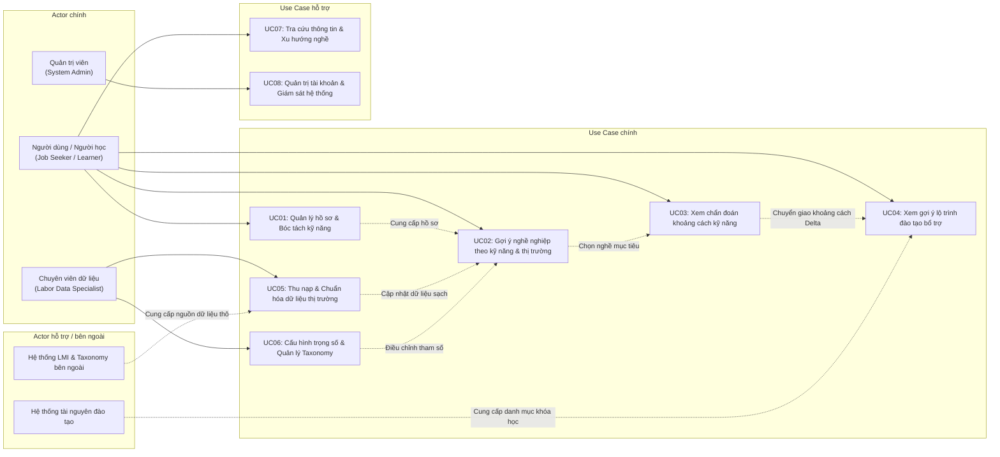

# Actor & Use Case

Hệ thống: **Skill- and Labor Market Demand–Based Career Recommendation System**  
(Hệ thống gợi ý nghề nghiệp dựa trên hồ sơ kỹ năng và nhu cầu thị trường lao động)

---

## 1. Actor

Hệ thống phân biệt rõ giữa **Actor chính** (người trực tiếp vận hành hoặc hưởng lợi từ chức năng cốt lõi) và **Actor hỗ trợ / bên ngoài** (hệ thống bên thứ ba cung cấp dữ liệu nền tảng).

### 1.1. Bảng danh sách Actor

| Actor | Mô tả | Vai trò | Phân loại |
|---|---|---|---|
| **Người dùng / Người học (Job Seeker / Learner)** | Sinh viên, người lao động hoặc người chuyển ngành có nhu cầu định hướng nghề nghiệp dựa trên năng lực thực tế. | Trực tiếp tương tác để khai báo/tải lên hồ sơ kỹ năng; nhận danh sách nghề nghiệp gợi ý; xem chẩn đoán khoảng cách kỹ năng và lộ trình học tập bổ trợ. | **Actor chính** |
| **Chuyên viên dữ liệu & Hướng nghiệp (Labor Data & Career Specialist)** | Chuyên viên nghiệp vụ phụ trách quản lý dữ liệu thị trường việc làm, từ điển kỹ năng và tư vấn định hướng. | Quản lý, kiểm duyệt từ điển kỹ năng (taxonomy); giám sát pipeline làm sạch dữ liệu việc làm; tinh chỉnh trọng số thuật toán gợi ý theo biến động thị trường. | **Actor chính** |
| **Quản trị viên hệ thống (System Administrator)** | Nhân sự quản trị kỹ thuật hệ thống. | Quản lý tài khoản người dùng, phân quyền truy cập, giám sát hiệu năng vận hành và bảo đảm an toàn dữ liệu hệ thống. | **Actor chính** |
| **Hệ thống dữ liệu thị trường & Danh mục chuẩn (External LMI & Taxonomy Service)** | Nền tảng hoặc API bên ngoài cung cấp chuẩn phân loại (O\*NET / ESCO) và thống kê thị trường lao động (BLS, Cổng việc làm). | Cung cấp nguồn cấp dữ liệu (data feed) về taxonomy kỹ năng chuẩn và dữ liệu thống kê nhu cầu việc làm cho hệ thống. | **Actor hỗ trợ / bên ngoài** |
| **Hệ thống tài nguyên đào tạo (External Learning Platform)** | Các nền tảng đào tạo trực tuyến (Coursera, edX) hoặc hệ thống danh mục khóa học (Course Catalog) của nhà trường. | Cung cấp danh mục khóa học, chứng chỉ ngắn hạn (micro-credentials) tương ứng với các kỹ năng cần bồi dưỡng. | **Actor hỗ trợ / bên ngoài** |

---

## 2. Use Case

Hệ thống tập trung vào các chức năng nghiệp vụ cốt lõi, chia thành hai mức độ: **Use Case chính** (nghiệp vụ bắt buộc) và **Use Case hỗ trợ/phụ thuộc**.

### 2.1. Bảng danh sách Use Case

| Mã UC | Use Case | Actor thực hiện | Mô tả ngắn & Mục đích | Kết quả đầu ra chính | Phân loại |
|---|---|---|---|---|---|
| **UC01** | Quản lý hồ sơ & Bóc tách kỹ năng cá nhân | Người dùng | Nhập thông tin hoặc tải lên CV (PDF/Word); hệ thống sử dụng NLP/LLM để tự động bóc tách kỹ năng và chuẩn hóa về từ điển O\*NET/ESCO. | Hồ sơ kỹ năng chuẩn hóa (Standardized Profile) | **Use Case chính** |
| **UC02** | Nhận gợi ý nghề nghiệp theo kỹ năng và nhu cầu thị trường | Người dùng | Hệ thống đối chiếu hồ sơ kỹ năng với cơ sở dữ liệu nghề nghiệp, tính toán độ tương thích ($Sim$) kết hợp trọng số nhu cầu thị trường tương lai ($Demand$) để xếp hạng các vị trí phù hợp nhất. | Danh sách nghề nghiệp gợi ý kèm điểm tương thích và chỉ số triển vọng thị trường | **Use Case chính** |
| **UC03** | Xem chẩn đoán khoảng cách kỹ năng (Skill Gap Analysis) | Người dùng | Đối với một nghề nghiệp được chọn, hệ thống phân tích chi tiết mức độ đáp ứng: kỹ năng đã có, kỹ năng còn thiếu ($\Delta$) và các kỹ năng bắc cầu (bridge skills). | Báo cáo chẩn đoán khoảng cách kỹ năng trực quan | **Use Case chính** |
| **UC04** | Xem gợi ý lộ trình đào tạo bổ trợ (Upskilling Pathway) | Người dùng, *Hệ thống tài nguyên đào tạo (hỗ trợ)* | Dựa trên khoảng cách kỹ năng đã chẩn đoán, hệ thống đề xuất các khóa học/chứng chỉ ngắn hạn phù hợp để người dùng bổ sung năng lực còn thiếu. | Danh sách khóa học và lộ trình bồi dưỡng kỹ năng cá nhân hóa | **Use Case chính** |
| **UC05** | Thu nạp & Chuẩn hóa dữ liệu thị trường lao động | Chuyên viên dữ liệu, *Hệ thống LMI bên ngoài (hỗ trợ)* | Thu thập dữ liệu tin tuyển dụng và báo cáo thống kê lao động; thực hiện lọc nhiễu, khử trùng lặp (deduplication) và ánh xạ vào taxonomy chuẩn. | Tập dữ liệu thị trường lao động sạch và cập nhật | **Use Case chính** |
| **UC06** | Cấu hình trọng số gợi ý & Quản lý Taxonomy | Chuyên viên dữ liệu | Điều chỉnh tỉ lệ ưu tiên giữa độ khớp kỹ năng và xu hướng thị trường; bổ sung hoặc cập nhật các kỹ năng mới nổi vào hệ thống ontology. | Bảng tham số thuật toán và từ điển kỹ năng chuẩn hóa | **Use Case chính** |
| **UC07** | Tra cứu thông tin & Xu hướng nghề nghiệp | Người dùng | Cho phép người dùng chủ động tìm kiếm thông tin về một nghề nghiệp cụ thể (mức lương, tốc độ tăng trưởng, bộ kỹ năng yêu cầu) độc lập với hồ sơ cá nhân. | Thông tin tổng quan và xu hướng của nghề nghiệp | **Use Case hỗ trợ** |
| **UC08** | Quản trị tài khoản & Giám sát hệ thống | Quản trị viên hệ thống | Quản lý tài khoản người dùng, giám sát trạng thái hoạt động của các tiến trình xử lý ngầm (background jobs) và nhật ký lỗi. | Báo cáo trạng thái vận hành hệ thống | **Use Case hỗ trợ** |

---

## 3. Quan hệ tổng quát

### 3.1. Phân định vai trò và phạm vi nghiệp vụ
* **Người dùng (Job Seeker / Learner)** là trung tâm của luồng nghiệp vụ thụ hưởng giá trị: Đi từ việc chuẩn hóa năng lực cá nhân (**UC01**), nhận gợi ý nghề nghiệp có triển vọng cao (**UC02**), hiểu rõ thiếu hụt năng lực (**UC03**) và nhận lộ trình khắc phục (**UC04**).
* **Chuyên viên dữ liệu (Labor Data Specialist)** bảo đảm chất lượng của tri thức hệ thống: Đảm bảo dữ liệu thị trường không bị nhiễu bởi tin ảo (**UC05**) và đảm bảo thuật toán không thiên lệch bằng việc kiểm soát trọng số và từ điển chuẩn (**UC06**).
* **Các tác nhân bên ngoài (External Services)** đóng vai trò nguồn cấp (data provider) phục vụ cho quá trình thu nạp dữ liệu và gợi ý khóa học mà không can thiệp trực tiếp vào quyết định của người dùng.

### 3.2. Sơ đồ quan hệ Use Case tổng quát

